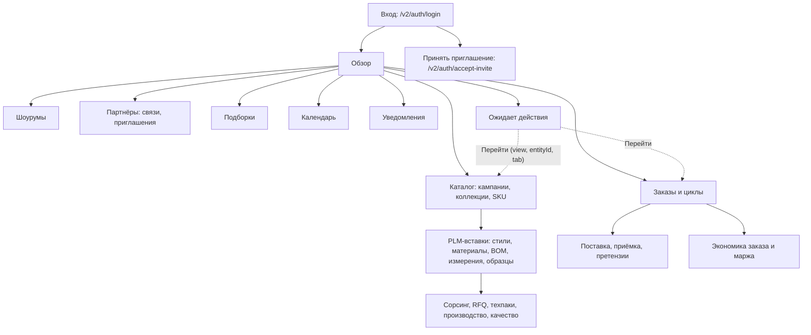
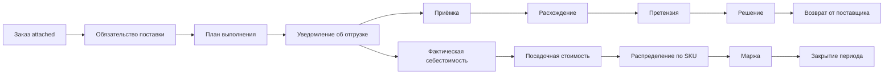
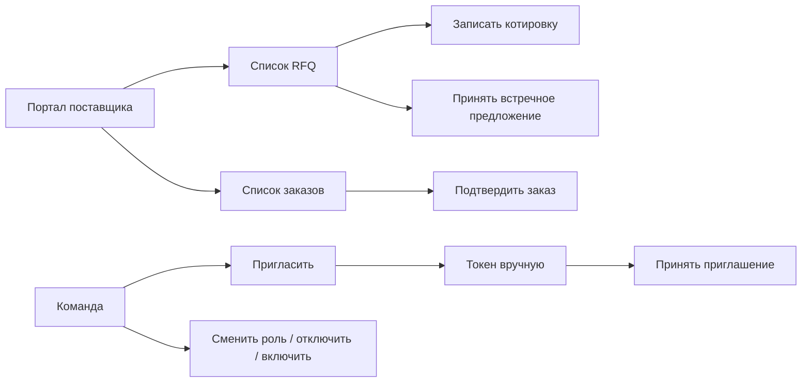
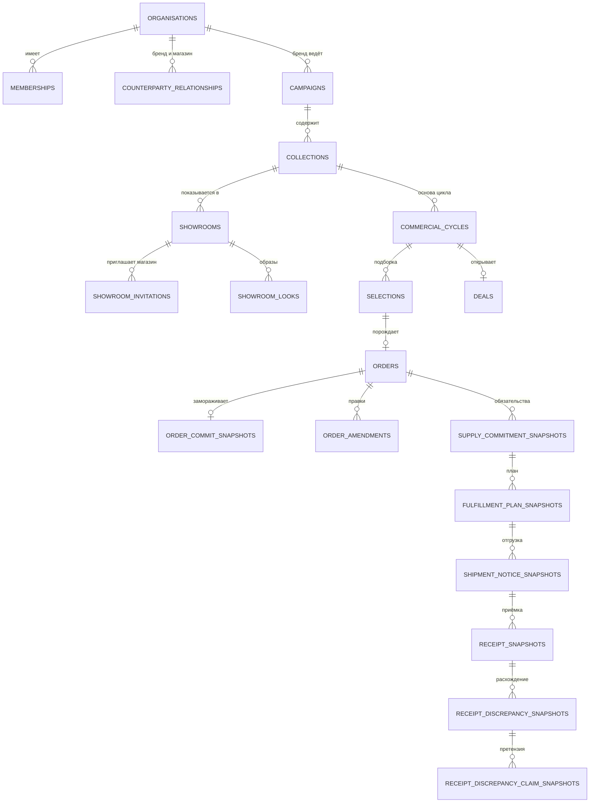
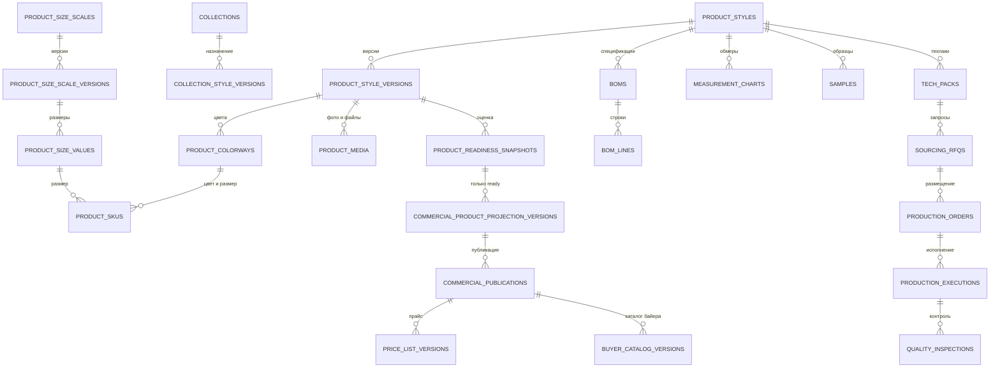

# Syntha V2: карта связей интерфейса, реестр действий, данные, роли, события

Дата: 2026-10-15. База: чистый клон опубликованной версии (ветка с пакетом документов, код как в main), только чтение. Код, сервер и тесты не запускались. Пути от корня репозитория; строки даны там, где они найдены поиском. Метки: **факт** подтверждён файлом, **предложение** и **гипотеза** нет.

Что где: диаграммы переходов экранов (раздел 1), реестр действий (2), модель данных (3), жизненные циклы кратко (4; подробно в `08-chain-state-machines-and-role-workspaces.md`), роли (5), события (6), интеграции (7), проблемы связности (8). Полный перечень 384 HTTP-маршрутов вынесен в приложение А в конце.

## 0. Как устроен интерфейс (факт)

- Одностраничное приложение без сборщика: `public/index.html` (142 строки) подключает 21 CSS и скрипты `/ui/*.js` из `public/modules/` (104 файла). Корень `
` (`public/index.html`).
- Состояние в одном объекте `state` (`token`, `user`, `workspace`, `notifications`, `view`, `sidebarCollapsed`), токен сессии в `sessionStorage` (`public/modules/app-core.js`:21–30).
- Навигация: 8 пунктов сайдбара (`NAV_GROUPS`, app-core.js:5–17): Обзор (`overview`); Разработка: Каталог (`catalog`); Оптовая коммерция: Шоурумы, Партнёры, Подборки, Заказы; Управление: Календарь, Уведомления. Функция `renderView` (app-core.js:529–541) знает только `partners, catalog, showrooms, selections, orders, calendar, notifications`, всё остальное падает в `renderOverview`.
- Остальные ~60 экранов PLM, сорсинга, производства и экономики **не пункты меню**: это вставки внутри экранов, панели и «Перейти» из списка «Ожидает действия» (`awaiting-action.js`, `workspace-hub.js`, `omnidata-workspace.js`, 1707 строк). Поэтому реальные переходы читаются по `AwaitingActionRoute { view, entityId, tab, ... }` (`src/http/awaiting-action-openapi.mjs`).
- Язык RU/EN через `public/modules/i18n-runtime.js`; режим окна `?viewport=monitor|tablet|phone` (`viewport-mode.js`).
- Отправка мутаций: функция `mutate(path, body)` и `api(path, options)` (`public/modules/api.js`); каждая мутация несёт `Idempotency-Key` (`src/http/pipeline.mjs`).
- Системы аналитики (счётчики, SDK) в коде **не найдены**: события во второй колонке реестра это события домена из журнала (`outbox_events`), столбец «аналитика» оформлен как предложение именованием `объект.действие`.

## 1. Карты экранов и переходов

### 1.1 Общий обзор

### 1.2 Поток «кампания → сделка»

```mermaid
flowchart LR
  C1["Каталог: Создать кампанию"] --> C2["Открыть кампанию"]
  C2 --> C3["Создать коллекцию"]
  C3 --> C4["Добавить модель в коллекцию"]
  C4 --> C5["Опубликовать коллекцию"]
  C5 --> S1["Шоурумы: Создать, Открыть"]
  S1 --> S2["Поделиться: приглашение магазину"]
  S2 --> P1["Партнёры: магазин принимает"]
  P1 --> CY["Цикл: Перейти по стадиям"]
  CY --> SE["Подборки: матрица, Отправить"]
  SE --> OR["Заказы: условия, принять обеими, Прикрепить"]
  OR --> DL["Открыть DealSpace"]
```

### 1.3 Поток PLM

```mermaid
flowchart LR
  ST["Стиль: Создать"] --> VER["Версия, цветовые модели, размерный ряд"]
  VER --> BM["BOM и измерения"]
  BM --> SMP["Образец: запросить, получить, решить"]
  SMP --> TP["Техпак: выпустить, подтвердить"]
  TP --> RFQ["RFQ: котировка, присудить, разместить"]
  RFQ --> PO["Производственный заказ: выпустить, подтвердить"]
  PO --> EX["Исполнение: вехи, внутрипроцессный контроль"]
  EX --> FQ["Финальный контроль: проверка, решение"]
  FQ --> RD["Оценка готовности"]
  RD --> CP["Коммерческая проекция и публикация"]
```

### 1.4 Поток инжиниринга с ИИ и пересчётом

### 1.5 Поток поставки, приёмки и экономики

### 1.6 Портал поставщика и команда

## 2. Реестр действий

Столбцы: ID; экран; элемент; действие; результат; данные и API; событие домена; кто может (способность, см. раздел 5); источник. Подписи кнопок сняты из кода (часть строк в коде записана escape-кодами `\uXXXX` и декодирована). Где «Кто может» не указано точно, написано «по сервису»: способность проверяется внутри сервиса, прямой связи маршрута с ней в роутере нет. Аналитика: см. раздел 0, предложение имён дано одним шаблоном в разделе 6.

### 2.1 Вход, оболочка, обзор

| ID | Экран | Элемент | Действие | Результат | Данные и API | Событие | Кто может | Источник |
|---|---|---|---|---|---|---|---|---|
| A-01 | Вход | Кнопка «Войти» (`auth.signIn`) | отправить форму | токен в `sessionStorage`, загрузка рабочего места, экран «Обзор»; при ошибке сообщение под формой | `POST /v2/auth/login` (email, пароль) | вход пишется в `auth_login_audit` | все, лимит неудачных попыток (`SYNTHA_AUTH_MAX_FAILURES`) | app-core.js:156–177; pipeline.mjs:63 |
| A-02 | Вход | «Принять приглашение» | открыть форму токена | экран приёма приглашения | локально (`renderAcceptInvite`) | нет | аноним | app-core.js:182–186 |
| A-03 | Приём приглашения | «Принять» | отправить токен и новый пароль | создаётся учётная запись, вход | `POST /v2/auth/accept-invite` | `membership.*` | владелец токена | team.js:205; pipeline.mjs:71 |
| A-04 | Вход (локально) | «Внести и войти» | подставить демо-данные и отправить | автоподстановка только если хост `localhost/127.0.0.1/::1` | `GET /__local/demo-login` | нет | локальный запуск | app-core.js:196–230 |
| A-05 | Оболочка | Пункт сайдбара | сменить `state.view`, `renderApp` | экран раздела | локально | нет | все | app-core.js:244–256 |
| A-06 | Оболочка | «Свернуть/Развернуть» сайдбар | переключить | значение в `localStorage` | локально | нет | все | app-core.js:29 |
| A-07 | Оболочка | Язык RU/EN | `I18N.setLocale` | перерисовка | локально | нет | все | app-core.js:518–525 |
| A-08 | Оболочка | «Обновить» | перечитать рабочее место | заново `me`, `workspace`, `notifications/page` | `GET /v2/auth/me`, `/v2/workspace`, `/v2/notifications/page` | нет | все | app-core.js:92–94, 272 |
| A-09 | Оболочка | «Выйти» | завершить сессию | токен отозван, экран входа | `POST /v2/auth/logout` | нет | все | app-core.js:397; api.js:51 |
| A-10 | Оболочка | Колокольчик | открыть «Уведомления» | `state.view='notifications'` | локально | нет | все | app-core.js:357 |
| A-11 | Обзор | «Ожидает действия»: фильтр группы/типа | запросить с `type, group, limit` | список задач и счётчики | `GET /v2/inbox/awaiting-action` | нет (чтение) | любой участник | awaiting-action.js:86–97 |
| A-12 | Обзор | «Перейти» у задачи | открыть экран по `AwaitingActionRoute` | экран, вкладка, запись, диалог | локально по ответу A-11 | нет | по роли | awaiting-action-openapi.mjs |
| A-13 | Обзор (поставщик) | Список портала | запросить задачи поставщика | отдельный список | `GET /v2/supplier-portal/awaiting-action` | нет | пользователь с допуском портала | awaiting-action.js:93 |
| A-14 | Любой список | «Загрузить ещё» (постраничный курсор) | страница раздела | доливает строки | `GET /v2/workspace/:section/page` | нет | по организации | workspace-pagination.js:69 |
| A-15 | Уведомления | Строка уведомления «Прочитано» | пометить прочитанным для себя | счётчик уменьшается; прочитал один человек, организации не мешает | `POST /v2/notifications/:id/read` | запись в `notification_reads` | получатель | views-4.js:146 |
| A-16 | Уведомления | «Ещё» | следующая страница | курсор | `GET /v2/notifications/page` | нет | получатель | notification-pagination.js:53 |

### 2.2 Каталог: кампании, коллекции, SKU, планирование

| ID | Экран | Элемент | Действие | Результат | Данные и API | Событие | Кто может | Источник |
|---|---|---|---|---|---|---|---|---|
| C-01 | Каталог | «Создать кампанию» | открыть форму и отправить | кампания `draft` | `POST /v2/campaigns` | `campaign.created` | `campaign.manage` бренда | campaign-form.js:16; platform.mjs:151 |
| C-02 | Каталог | «Открыть» у кампании | `draft→open` | кампания открыта | `POST /v2/campaigns/:id/open` | `campaign.opened` | `campaign.manage` | views-3.js:33; omnidata-workspace.js:1208 |
| C-03 | Каталог | «Создать коллекцию» | форма | коллекция `draft`, валюта ISO | `POST /v2/collections` | `collection.created` | `collection.manage` | collection-form.js:12 |
| C-04 | Каталог | «Добавить модель» (в коллекцию) | форма выбора версий стиля | назначение, только у `draft` | `POST /v2/collections/:id/style-versions` | `collection.style-version-assigned` | `collection.manage` | product-chain-forms.js:478–486 |
| C-05 | Каталог | «Опубликовать» (коллекция) | `draft→published` | коллекция опубликована, доступна шоурумам | `POST /v2/collections/:id/publish` | `collection.published` | `collection.manage` | views-3.js:41; omnidata-workspace.js:1218 |
| C-06 | Каталог | «Создать SKU» | форма | SKU `draft` (совместимость, см. `PUB-005`) | `POST /v2/catalog/skus` | `catalog-sku.created` | `catalog.manage` | catalog-form.js:15 |
| C-07 | Каталог | «Редактировать» SKU | правка по `version` | обновление черновика | `PATCH /v2/catalog/skus/:id` | `catalog-sku.updated` | `catalog.manage` | catalog.js:63; catalog-form.js:41 |
| C-08 | Каталог | «Опубликовать» SKU | `draft→published` | SKU виден в публикациях | `POST /v2/catalog/skus/:id/publish` | `catalog-sku.published` | `catalog.manage` | catalog.js:46 |
| C-09 | Планирование | Создать плейсхолдер | форма | строка плана | `POST /v2/assortment/placeholders` | `assortment.placeholder.planned` | `campaign.manage` | product-chain-forms.js:546 |
| C-10 | Планирование | Скачать шаблон импорта | скачать | описание контракта импорта | `GET /v2/assortment/placeholders/import/template` | нет | `campaign.manage` | placeholder-import.js:412 |
| C-11 | Планирование | Загрузить импорт плейсхолдеров | отправить файл строк | строки плана массово | `POST /v2/assortment/placeholders/import` | `assortment.placeholders.imported` | `campaign.manage` | placeholder-import.js:174 |
| C-12 | Планирование | Перевести плейсхолдер | `planned→in_development→delivered/dropped` | новое состояние | `POST /v2/assortment/placeholders/:id/transition` | `assortment.placeholder.transitioned` | `campaign.manage` | planning.js:223 |
| C-13 | Планирование | Связать стиль с плейсхолдером | выбрать стиль | связь | `POST /v2/assortment/placeholders/:id/styles` | `assortment.placeholder.style-linked` | `campaign.manage` | product-chain-forms.js:357 |
| C-14 | Планирование | Экономика сезона | открыть | расчёт по кампании | `GET /v2/campaigns/:id/season-economics` | нет | по сервису | planning.js:306 |
| C-15 | Палитра сезона | «Добавить» цвет | запись в палитру | цвет из справочника | `POST /v2/campaigns/:id/palette`; `GET /v2/libraries/colour.colour/entries` | нет в списке событий | по сервису | season-palette.js:82–127 |
| C-16 | Курсы | «Записать» сезонный курс | сохранить | курс на сезон | `POST /v2/season-fx-rates` | нет | по сервису | currency-rates.js:151 |

### 2.3 Стили, материалы, BOM, измерения, образцы, техпаки

| ID | Экран | Элемент | Действие | Результат | Данные и API | Событие | Кто может | Источник |
|---|---|---|---|---|---|---|---|---|
| S-01 | Стили | Создать стиль | форма | стиль `draft` | `POST /v2/product/styles` | нет в перечне событий; команда в `product_identity_commands` | `product.manage` | product-chain-forms.js:355 |
| S-02 | Стили | Новая версия стиля | форма | версия | `POST /v2/product/styles/:id/versions` | по сервису | `product.manage` | product-chain-forms.js:356, 385 |
| S-03 | Стили | Перевод жизненного цикла | выбрать разрешённое состояние | только из `allowedStyleTransitions`; для готовых нужна оценка | `POST /v2/product/styles/:id/transition`; `GET /v2/product/lifecycle` | по сервису | `product.manage` | styles.js:79, 120 |
| S-04 | Стили | «Назначить» ответственного | выбрать участника | запись ответственности | `POST /v2/product/styles/:id/responsibilities` | `product.responsibility.assigned` | `campaign.manage` | styles.js:705 |
| S-05 | Стили | Снять ответственность | освободить | запись снята | `POST /v2/product/responsibilities/:id/release` | `product.responsibility.released` | `campaign.manage` | styles.js:723 |
| S-06 | Стили | «Добавить» цветовую модель | форма | colorway | `POST /v2/product/style-versions/:id/colorways` | по сервису | `product.manage` | styles.js:835 |
| S-07 | Стили | Массовое добавление цветов | пакет | несколько colorway | `POST /v2/product/style-versions/:id/colorways/batch` | по сервису | `product.manage` | styles.js:889 |
| S-08 | Стили | «Добавить» медиа | ссылка и роль | запись `product_media` (hero, gallery, technical, ...) | `POST /v2/product/style-versions/:id/media` | по сервису | `product.manage` | styles.js:918 |
| S-09 | Стили | «Сохранить» атрибуты | значения | атрибуты | `POST /v2/product/attributes`; `GET /v2/product/style-versions/:id/category-attributes` | по сервису | `product.manage` | styles.js:946, 974 |
| S-10 | Стили | «Добавить» референс | ссылка | доска референсов стиля | `POST /v2/product/styles/:id/references` | по сервису | `product.manage` | styles.js:1290 |
| S-11 | Стили | «Добавить» узел конструкции | из справочника `design.construction_node` | запись | `POST /v2/product/styles/:id/construction-nodes` | по сервису | `product.manage` | styles.js:1349, 1406 |
| S-12 | Стили | «Добавить» SKU | из матрицы цвет×размер | ProductSku (GTIN) | `POST /v2/product/skus` | по сервису | `product.manage` | styles.js:454; product-chain-forms.js:456 |
| S-13 | Стили | Привязать SKU к каталожному | связь | совместимость `catalog_skus` | `POST /v2/product/skus/:id/catalog-link` | по сервису | `product.manage` | product-chain-forms.js:511 |
| S-14 | Размерные ряды | Создать/обновить ряд, версию, значения | формы | ряд, версия, значения размеров | `POST/PATCH /v2/product/size-scales`, `.../versions`, `/v2/product/size-scale-versions/:id/values` | по сервису | `product.manage` | product-chain-forms.js:420–449 |
| S-15 | Стили | «Добавить» сертификат / «Выставить» / «Продлить» | карточка сертификации | `draft→issued→superseded` | `POST /v2/product-certifications`, `/:id/issue`, `/:id/supersede` | `product-certification.*` | `product-certification.manage` (quality) | styles.js:1154–1195 |
| S-16 | Стили | История изменений | открыть | журнал и атрибуты | `GET /v2/history/:id`, `/attributes` | нет | `product.read` | styles.js:205, 278 |
| S-17 | Готовность | Оценить готовность версии | запуск | `ProductReadinessSnapshot` ready/blocked | `POST /v2/product/style-versions/:id/readiness` | по сервису | `product.manage` | product-readiness-assessment.js:258 |
| S-18 | Готовность | Шаблон ростовки (pack ratio) | создать/читать | шаблон | `POST/GET /v2/product/pack-ratio-templates` | по сервису | по сервису | product-readiness-assessment.js:112–134 |
| S-19 | Готовность | Опубликовать коммерческую проекцию | из `ready` | `CommercialProductProjectionVersion` | `POST /v2/product/readiness/:id/commercial-projection` | по сервису | `product.manage` | product-readiness-panel.js:199 |
| M-01 | Материалы | Создать материал | форма | материал `draft` | `POST /v2/materials` | `material.created` | по сервису | materials.js:176 |
| M-02 | Материалы | Изменить | правка по версии | обновление | `PATCH /v2/materials/:id` | `material.updated` | по сервису | materials.js:185 |
| M-03 | Материалы | Опубликовать | `draft→published` | материал опубликован | `POST /v2/materials/:id/publish` | `material.published` | по сервису | materials.js:239 |
| M-04 | Материалы | Создать цвет / лабдип | форма | цвет материала и лабдип | `POST /v2/material-colours`, `/v2/lab-dips` | нет в перечне | по сервису | materials.js:453, 481 |
| M-05 | Материалы | Лабдип: отправить, решить, отменить | кнопки | статусы лабдипа | `POST /v2/lab-dips/:id/submit|decide|cancel` | нет | по сервису | materials.js:495–531 |
| M-06 | Материалы | Партия: создать, выпустить, карантин, отклонить, выдать | кнопки | статус партии `quarantine/released/rejected`, расход | `POST /v2/material-lots`, `/:id/issue`, `/:id/release|quarantine|reject` | нет | по сервису | material-lot-actions.js:74–174 |
| B-01 | BOM | Создать BOM | форма | BOM `draft` | `POST /v2/boms` | `bom.created` | `bom.manage` | bom.js:457 |
| B-02 | BOM | Изменить строки | правка | обновление | `PATCH /v2/boms/:id` | `bom.updated` | `bom.manage` | bom.js:456 |
| B-03 | BOM | Опубликовать | `draft→published` | BOM для техпака | `POST /v2/boms/:id/publish` | `bom.published` | `bom.manage` | bom.js:290 |
| B-04 | Стиль | Строки BOM по размерам | открыть | размерные строки | `GET /v2/product/styles/:id/bom-size-line` | нет | `bom.read` | styles.js:1512 |
| MS-01 | Измерения | Создать/изменить таблицу | форма | таблица обмеров | `POST /v2/measurements`, `PATCH /v2/measurements/:id` | `measurement.created/updated` | `measurement.manage` | measurements.js:506–507 |
| MS-02 | Измерения | Опубликовать | `draft→published` | ревизия опубликована | `POST /v2/measurements/:id/publish` | `measurement.published` | `measurement.manage` | measurements.js:263 |
| MS-03 | Измерения | Каноническая таблица: создать/изменить/опубликовать | форма | канон | `POST/PATCH /v2/measurements/canonical`, `/:id/publish` | `measurement.*` | `measurement.manage` | canonical-measurement-form.js:163–351 |
| MS-04 | Измерения | Новая ревизия | кнопка | ревизия | `measurement.revision-started` | `measurement.revision-started` | `measurement.manage` | measurement-revision-actions.js:69 |
| SM-01 | Образцы | Создать/изменить образец | форма | образец `draft` | `POST /v2/samples`, `PATCH /v2/samples/:id` | `sample.created/updated` | `sample.manage` | samples.js:314–315 |
| SM-02 | Образцы | Запросить | `draft→requested` | запрос (нужен опубликованный SKU) | `POST /v2/samples/:id/request` | нет | `sample.manage` | samples.js:332 |
| SM-03 | Образцы | В производство / Получить | `requested→in-production→received` | статусы | `POST /v2/samples/:id/start-production`, `/receive` | нет | `sample.manage` | samples.js:332–335 |
| SM-04 | Образцы | Подтвердить / Отклонить | решение для `received` | `approved/rejected` | `POST /v2/samples/:id/decision` | нет | `sample.manage` | samples.js:338 |
| SM-05 | Образцы | Отменить / Следующий раунд | отмена; новый раунд из `rejected` | `cancelled` / новый образец | `POST /v2/samples/:id/cancel`, `/next-round` | `sample.next-round-created` | `sample.manage` | samples.js:341–344 |
| T-01 | Техпаки | Создать/изменить | форма | техпак `draft` | `POST /v2/tech-packs`, `PATCH /v2/tech-packs/:id` | `tech-pack.created/updated` | `tech-pack.manage` | tech-packs.js:458–459 |
| T-02 | Техпаки | «Выпустить» | `draft→issued` (нужны опубликованные SKU, BOM, измерения, одобренный образец) | выпущен | `POST /v2/tech-packs/:id/issue` | `tech-pack.issued` | `tech-pack.manage` | tech-packs.js:468 |
| T-03 | Техпаки | «Зафиксировать» (подтверждение фабрикой) | `issued→acknowledged` | подтверждён | `POST /v2/tech-packs/:id/acknowledge` | `tech-pack.acknowledged` | `tech-pack.acknowledge` | tech-packs.js:470 |
| T-04 | Техпаки | «Создать редакцию» | новая ревизия активного | старый `superseded` | `POST /v2/tech-packs/:id/revisions` | `tech-pack.revision-created` | `tech-pack.manage` | tech-packs.js:472 |
| T-05 | Техпаки | «Отозвать» | `withdrawn` | отозван | `POST /v2/tech-packs/:id/withdraw` | `tech-pack.withdrawn` | `tech-pack.manage` | tech-packs.js:474 |
| T-06 | Техпаки | Открыть документ | просмотр | печатный вид | `GET /v2/tech-packs/:id/document` | нет | `tech-pack.read` | tech-packs.js:149 |

### 2.4 Сорсинг, закупка, производство, качество

| ID | Экран | Элемент | Действие | Результат | Данные и API | Событие | Кто может | Источник |
|---|---|---|---|---|---|---|---|---|
| R-01 | Поставщики | «Сохранить» поставщика | создать/изменить | `draft` | `POST /v2/suppliers`, `PATCH /v2/suppliers/:id` | `supplier.created` | `supplier.manage` | sourcing.js:761–762 |
| R-02 | Поставщики | «Квалифицировать» | `draft/suspended→qualified` | поставщик годен для RFQ | `POST /v2/suppliers/:id/qualify` | нет | `supplier.manage` | sourcing.js:775 |
| R-03 | Поставщики | «Приостановить» / «В архив» | статусы | `suspended` / `archived` | `POST /v2/suppliers/:id/suspend|archive` | нет | `supplier.manage` | sourcing.js:777–780 |
| R-04 | Поставщики | «Открыть доступ» / «Отозвать» | допуск в портал | допуск поставщика | `POST /v2/suppliers/:id/portal-access`, `/revoke` | `supplier.portal-access-granted/revoked` | `supplier.manage` | sourcing.js:579–589 |
| R-05 | Поставщики | Экономика поставщика | открыть | метрики | `GET /v2/suppliers/:id/economic-performance` | нет | по сервису | sourcing.js:502 |
| R-06 | RFQ | «Сохранить» RFQ | создать/изменить | `draft` | `POST /v2/rfqs`, `PATCH /v2/rfqs/:id` | `rfq.created` | `sourcing.manage` | sourcing.js:790–791 |
| R-07 | RFQ | «Отправить» | `draft→issued` | отправлен поставщикам | `POST /v2/rfqs/:id/issue` | нет | `sourcing.manage` | sourcing.js:796 |
| R-08 | RFQ | «Записать котировку» | котировка | `issued→quoted` | `POST /v2/rfqs/:id/quotes` | нет | `sourcing.manage` | sourcing.js:800 |
| R-09 | RFQ | «Отправить встречное предложение» / «Принять» | торг | встречное и принятие | `POST /v2/rfqs/:id/counter-offer`, `/accept` | нет | `sourcing.manage` | sourcing.js:811–823 |
| R-10 | RFQ | «Подтвердить выбор» | присуждение | `quoted→awarded` | `POST /v2/rfqs/:id/award` | нет | `sourcing.award` | sourcing.js:827 |
| R-11 | RFQ | «Создать PO и разместить» | `awarded→allocated` и производственный заказ | PO | `POST /v2/rfqs/:id/allocate`, `POST /v2/production-orders/from-allocation/:id` | `production-order.created` | `production.allocate` | sourcing.js:837–853 |
| R-12 | RFQ | «Отменить RFQ» | отмена до `allocated` | `cancelled` | `POST /v2/rfqs/:id/cancel` | нет | `sourcing.manage` | sourcing.js:865 |
| R-13 | RFQ материалов | Сохранить, отправить, котировка, торг, выбор, разместить, заказ, отменить | цепочка как у RFQ | RFQ материалов и закупочный заказ | `/v2/material-rfqs` и подмаршруты (issue, quotes, counter-offer, award, allocate, purchase-order, cancel) | `material-rfq.created` | `material-purchase.manage` | sourcing.js:995–1095 |
| R-14 | Закупочный заказ материалов | «Отправить», «Зафиксировать», «Отменить заказ» | `draft→issued→confirmed`, `cancelled` | статусы | `POST /v2/material-purchase-orders/:id/issue|confirm|cancel` | `material-purchase-order.*` | `material-purchase.manage` | sourcing.js:1145–1155 |
| P-01 | Производственные заказы | «Выпустить» | `draft→issued` | отправлен фабрике | `POST /v2/production-orders/:id/issue` | `production-order.issued` | `production-order.manage` | production-orders.js:231 |
| P-02 | Производственные заказы | «Подтвердить» (подтверждает поставщик) | `issued→confirmed` | подтверждён | `POST /v2/production-orders/:id/confirm` | `production-order.confirmed` | `production-order.confirm` | production-orders.js:230 |
| P-03 | Производственные заказы | «Отменить» | `draft/issued→cancelled`, освобождает RFQ | отмена | `POST /v2/production-orders/:id/cancel` | `production-order.cancelled` | `production-order.manage` | production-orders.js (кнопка отмены) |
| P-04 | Производственные заказы | График платежей: создать, записать платёж | расписание | вехи `planned/due/overdue/paid` | `POST /v2/production-orders/:id/payment-schedule`, `/payments` | нет | по сервису | production-orders.js:114–136 |
| P-05 | Производственные заказы | Целевая цена | читать | цена SKU | `GET /v2/catalog-skus/:id/target-price` | нет | по сервису | production-orders.js:27 |
| E-01 | Исполнение | Создать из заказа | `from-production-order` | `planned` | `POST /v2/production-executions/from-production-order/:id` | `production-execution.created` | `production-execution.manage` | production-executions.js:388 |
| E-02 | Исполнение | Старт | `planned→active` | старт | `POST /v2/production-executions/:id/start` | `production-execution.started` | `production-execution.manage` | production-executions.js:663 |
| E-03 | Исполнение | Веха: завершить / заблокировать / снять блок | вехи | при всех завершённых `ready-for-qc` | `POST /v2/production-executions/:id/milestones/complete|block|resolve` | `production-milestone.blocked/unblocked` | `production-execution.manage` | production-executions.js:472–499 |
| E-04 | Исполнение | Отменить | кнопка | `cancelled`, нельзя при живой инспекции | `POST /v2/production-executions/:id/cancel` | `production-execution.cancelled` | `production-execution.manage` | production-executions.js:509 |
| E-05 | Исполнение | Внутрипроцессный контроль: записать, решение | проверка и disposition | `open/closed` | `POST /v2/production-executions/:id/inline-quality-checks`, `/v2/inline-quality-checks/:id/disposition` | `inline-quality.dispositioned` | `quality.manage` | production-executions.js:576, 634 |
| E-06 | Исполнение | Дефект: добавить | справочник дефектов | тип дефекта | `POST /v2/defect-types`; (`/retire` без UI) | `defect-type.registered` | `quality.manage` | production-executions.js:135 |
| E-07 | Исполнение | Трассируемость материалов | открыть | партии материала | `GET /v2/production-executions/:id/material-traceability` | нет | `production-execution.read` | production-executions.js:154 |
| Q-01 | Финальный контроль | Создать из исполнения | старт инспекции | `planned` | `POST /v2/final-quality-inspections/from-execution/:id` | `final-quality.created` | `quality.manage` | final-quality.js:158 |
| Q-02 | Финальный контроль | Старт / Завершить прогон | выборка AQL | `in-progress→review-pending` | `.../start`, `.../complete-run` | `final-quality.run-started/completed` | `quality.manage` | final-quality.js:301 |
| Q-03 | Финальный контроль | Решение (выпустить/доработка/отклонить) | review | `released/rework-required/rejected` | `POST /v2/final-quality-inspections/:id/review` | нет в перечне | `quality.approve` | final-quality.js:311 |
| Q-04 | Финальный контроль | Повторная проверка / Отменить | кнопки | новая попытка / `cancelled` | `.../reinspect`, `.../cancel` | `final-quality.reinspection-started/cancelled` | `quality.manage` | final-quality.js:263, 396 |

### 2.5 Шоурумы, партнёры, подборки, заказы, поставка

| ID | Экран | Элемент | Действие | Результат | Данные и API | Событие | Кто может | Источник |
|---|---|---|---|---|---|---|---|---|
| H-01 | Шоурумы | Создать шоурум | форма (коллекция опубликована) | `draft` | `POST /v2/showrooms` | `showroom.created` | `showroom.manage` | showroom-form.js:14 |
| H-02 | Шоурумы | «Открыть» | `draft→open` | показ идёт | `POST /v2/showrooms/:id/open` | `showroom.opened` | `showroom.manage` | views-3.js:52 |
| H-03 | Шоурумы | «Закрыть показ» | `open→closed` | закрыт (нужна версия) | `POST /v2/showrooms/:id/close` | `showroom.closed` | `showroom.manage` | views-3.js:54 |
| H-04 | Шоурумы | Образы: добавить, изменить, убрать | лукбук | образ с товарами и https-картинкой | `POST/GET /v2/showrooms/:id/looks`, `PATCH/DELETE /v2/showroom-looks/:id` | `showroom.look-added/changed/removed` | `showroom.manage` | showroom-looks.js:29–153 |
| H-05 | Шоурумы | Поделиться (приглашение) | форма | приглашение магазину | `POST /v2/showrooms/:id/invitations` | `showroom-invitation.created` | `showroom-invitation.manage` | forms-3.js:11 |
| H-06 | Шоурумы | Опубликовать коммерческую публикацию | выбор проекций | `CommercialPublication` | `POST /v2/commercial-publications`; `GET /v2/collections/:id/publishable-projections` | `commercial-publication.published` | `catalog.manage` (по сервису) | commercial-publication-actions.js:41–52 |
| H-07 | Шоурумы | Опубликовать каталог байера | версия каталога магазина | `BuyerCatalogVersion` | `POST /v2/commercial-publications/:id/buyer-catalogs` | `buyer-catalog-version.published`, `price-list-version.published` | по сервису | commercial-publication-actions.js:98 |
| H-08 | Шоурумы | Откат каталога | «У этого каталога нет прежних версий» при пустой истории | новая версия из старой | `POST /v2/buyer-catalog-versions/:id/rollback` | `buyer-catalog-version.rolled-back`, `price-list-version.restored` | по сервису | commercial-publication-actions.js:170 |
| N-01 | Партнёры | Запросить связь | форма | `pending` | `POST /v2/relationships` | `counterparty-relationship.requested` | `partner-relationship.manage` | relationship-form.js:19 |
| N-02 | Партнёры | Принять / Отклонить / Отозвать связь | кнопки | `active/rejected/revoked` | `POST /v2/relationships/:id/accept|reject|revoke` | `counterparty-relationship.*` | `partner-relationship.manage` | views-3.js:7–12 |
| N-03 | Партнёры | Принять / Отклонить приглашение (магазин) | кнопки | `accepted/declined` | `POST /v2/invitations/:id/accept|decline` | `showroom-invitation.accepted/declined` | `showroom-invitation.accept` | views-3.js:21–22 |
| N-04 | Партнёры | Отозвать приглашение (бренд) | кнопка | `revoked` | `POST /v2/invitations/:id/revoke` | `showroom-invitation.revoked` | `showroom-invitation.manage` | views-3.js:26 |
| N-05 | Торговые точки | Создать/изменить точку | форма (Bill-to и др.) | точка магазина | `POST /v2/shops/:id/doors`, `PATCH /v2/retail-doors/:id` | `retail-door.created/updated` | `retail-door.manage` | retail-doors.js:124–139 |
| N-06 | Торговые точки | Деактивировать / Активировать | кнопки | статус | `POST /v2/retail-doors/:id/deactivate|reactivate` | `retail-door.deactivated/reactivated` | `retail-door.manage` | retail-doors.js:96–104 |
| SE-01 | Подборки | Начать цикл | форма | `commercial_cycles`, стадия `campaign` | `POST /v2/cycles` | `commercial-cycle.started` | `commercial-cycle.create` | forms-3.js:22 |
| SE-02 | Подборки | «Перейти: <стадия>» | до стадии `showroom` | цикл продвинут | `POST /v2/cycles/:id/advance` | `commercial-cycle.advanced` | `commercial-cycle.advance` | order-lifecycle-actions.js:132; views-4.js:7 |
| SE-03 | Подборки | Закрыть цикл | с причиной | `closed` | `POST /v2/cycles/:id/close` | `commercial-cycle.closed`, `order.cancelled` | `commercial-cycle.advance` | forms-3.js:179 |
| SE-04 | Подборки | Создать подборку | форма (каталог байера, точка) | `draft` | `POST /v2/selections`; `GET /v2/shops/:id/doors` | `selection.created` | `selection.write` | forms-3.js:56 |
| SE-05 | Подборки | Матрица цвет×размер: изменить ячейки и сохранить | сохранить матрицу | строки подборки заменены | `PUT /v2/selections/:id/matrix` | `selection.matrix-replaced` | `selection.write` | linesheet-matrix-core.js:263; linesheets.js |
| SE-06 | Подборки | Изменить одну строку | строка | upsert | `PUT /v2/selections/:id/lines/:sku` | `selection.line-upserted` | `selection.write` | forms-3.js:88 |
| SE-07 | Подборки | «Отправить» | `draft→submitted`; предупреждение «Сначала сохраните изменения матрицы» | заморожена | `POST /v2/selections/:id/submit` | `selection.submitted` (+ уведомление) | `selection.write` | linesheets.js:1125; views-4.js:21 |
| SE-08 | Подборки | На согласование | `draft→pending_approval` | ждёт согласующего | `POST /v2/selections/:id/request-approval` | `selection.approval-requested` | `selection.write` | omnidata-workspace.js:1358 |
| SE-09 | Подборки | Согласовать | `pending_approval→submitted` | согласована | `POST /v2/selections/:id/approve` | `selection.approved` | `selection.approve` (finance) | omnidata-workspace.js:1362 |
| SE-10 | Подборки | Отклонить | с причиной | обратно в `draft` | `POST /v2/selections/:id/reject` | `selection.rejected` | `selection.approve` | omnidata-workspace.js:1341 |
| O-01 | Заказы | Создать заказ из подборки | форма условий | `draft` | `POST /v2/orders` | `order.draft-created` | `order.write` | forms-3.js:117 |
| O-02 | Заказы | Изменить условия | правка | сброс принятий | `PATCH /v2/orders/:id/terms` | `order.terms-revised` | `order.write` | order-lifecycle-actions.js:10 |
| O-03 | Заказы | Принять условия | сторона принимает | обе → `ready` | `POST /v2/orders/:id/accept` | `order.terms-accepted` (+ уведомление) | `order.write` | order-lifecycle-actions.js:30; views-4.js:32 |
| O-04 | Заказы | «Прикрепить к циклу» | `ready→attached` | `OrderCommitSnapshot` | `POST /v2/orders/:id/attach` | `order.commit-snapshot-created`, `order.attached` | `order.write` | order-lifecycle-actions.js:39; views-4.js:45 |
| O-05 | Заказы | «Открыть DealSpace» | подтверждение | стадии `confirmation→deal-space`, сделка, календарь | `POST /v2/cycles/:id/confirm` | `order.confirmed`, `deal-space.opened` (+ уведомление) | `order.confirm` | order-lifecycle-actions.js:139; views-4.js:8 |
| O-06 | Заказы | Отменить заказ | с причиной | `cancelled`, снимает резервы | `POST /v2/orders/:id/cancel` | `order.cancelled` | `order.write` | forms-3.js:168 |
| O-07 | Заказы | Предложить правку количества | строка и причина | `proposed` | `POST /v2/orders/:id/amendments` | `order.amendment-proposed` | `order.write` | order-fulfillment-view.js:492 |
| O-08 | Заказы | Принять / Отклонить правку | ответ другой стороны (причина отказа) | новая ревизия снимка или `rejected` | `POST /v2/orders/:id/amendments/:id/respond` | `order.commit-snapshot-revised` | `order.write` | order-fulfillment-view.js:509–524 |
| O-09 | Заказы | Комментарий к строке | запись | текст по строке | `PUT /v2/orders/:id/lines/:n/comment`; `GET /v2/orders/:id/comments` | `order.line-comment-set/cleared` | `order.write` / `logistics.read` | order-fulfillment-view.js:197–226 |
| O-10 | Заказы | Распределение по торговым точкам | количество по точке | аллокация | `PUT /v2/orders/:id/lines/:n/door-allocations/:doorId` | `order.line-door-allocation-set/cleared` | `order.write` | order-fulfillment-view.js:308–324 |
| O-11 | Календарь заказа | Добавить веху / применить шаблон | «обеим сторонам», «Дата-якорь» | вехи | `POST /v2/orders/:id/calendar-milestones`, `/apply-template`; `POST /v2/organisations/:id/calendar-templates` | `order.calendar-milestone-added`, `order.calendar-template-applied` | `order.write` | order-fulfillment-view.js:371–452 |
| F-01 | Поставка | Обязательство поставки | создать | `supply_commitment_snapshots` | `POST /v2/orders/:id/supply-commitments` | `supply-commitment.created` | `supply.manage` | order-fulfillment-actions.js:452 |
| F-02 | Поставка | План выполнения | создать | `fulfillment_plan_snapshots` | `POST /v2/orders/:id/fulfillment-plans` | `fulfillment.plan.created.v1` | `fulfillment.manage` | order-fulfillment-actions.js:454 |
| F-03 | Поставка | Статус упаковки | `packing→packed` | вес статуса | `PUT /v2/fulfillment-plans/:id/packing-status` | `fulfillment.packing-status.advanced.v1` | `fulfillment.manage` | order-fulfillment-view.js:285 |
| F-04 | Поставка | Уведомление об отгрузке | создать | `shipped` | `POST /v2/fulfillment-plans/:id/shipment-notices` | `fulfillment.shipment-notice.created.v1` | `fulfillment.manage` | order-fulfillment-actions.js:496 |
| F-05 | Поставка | Принять поставку (магазин) | запись приёмки | `received`, расхождение | `POST /v2/shipment-notices/:id/receipts` | `fulfillment.receipt.recorded.v1`, `fulfillment.receipt-discrepancy.actualized.v1`, `inventory.receipt-posted.v1` | `receipt.manage` | order-fulfillment-actions.js:522 |
| F-06 | Поставка | Подать претензию | по расхождению | `submitted` | `POST /v2/receipt-discrepancies/:id/claims` | `receipt-claim.submitted.v1` | `claim.manage` | order-fulfillment-actions.js:546 |
| F-07 | Поставка | Решить претензию | решение | `resolved` | `POST /v2/receipt-claims/:id/resolutions` | `receipt-claim.resolved.v1` | `claim.resolve` | order-fulfillment-actions.js:554 |
| F-08 | Поставка | Зафиксировать возврат от поставщика | запись | `supplier_claim_recovery_snapshots` | `POST /v2/receipt-claim-resolutions/:id/supplier-recoveries` | `supplier-recovery.recorded.v1` | по сервису | order-fulfillment-actions.js:581 |

### 2.6 Экономика, команда, портал, инжиниринг, коллаборация, документы

| ID | Экран | Элемент | Действие | Результат | Данные и API | Событие | Кто может | Источник |
|---|---|---|---|---|---|---|---|---|
| X-01 | Экономика заказа | Зафиксировать курс заказа | запись | `order_fx_rate_snapshots` | `POST /v2/orders/:id/fx-rate-snapshots` | `fx-rate.snapshot-recorded` | `cost.manage` | order-economics-workspace.js:464 |
| X-02 | Экономика заказа | Записать фактическую затрату | запись | `actual_cost_ledger_entries` | `POST /v2/orders/:id/actual-costs` | `actual-cost.recorded` | `cost.manage` | order-economics-workspace.js:465 |
| X-03 | Экономика заказа | Исправить затрату (только API) | сторно и замена, append-only | в UI вызова не найдено | `POST /v2/orders/:id/actual-costs/:id/corrections`; для поставки `POST /v2/shipment-notices/:id/actual-costs` и `.../corrections` | `actual-cost.corrected`, `actual-cost.reversed` | `cost.manage` | order-economics-routes.mjs, fulfillment-routes.mjs |
| X-04 | Экономика заказа | Посадочная стоимость | актуализировать | `landed_cost_snapshots` | `POST /v2/orders/:id/landed-cost/actualize` | `landed-cost.actualized` | `cost.manage` | order-economics-workspace.js:466 |
| X-05 | Экономика заказа | Политика распределения | создать | `cost_allocation_policy_versions` | `POST /v2/brands/:id/cost-allocation-policies` | `cost-allocation.policy-approved` | `cost.manage` | order-economics-workspace.js:473 |
| X-06 | Экономика заказа | Запуск распределения | расчёт | `cost_allocation_run_snapshots` | `POST /v2/orders/:id/cost-allocation-runs` | `cost-allocation.actualized` | `cost.manage` | order-economics-workspace.js:467 |
| X-07 | Экономика заказа | Маржа | актуализировать | `margin_actualization_snapshots` | `POST /v2/orders/:id/margin/actualize` | `margin.actualized` | `cost.manage` | order-economics-workspace.js:468 |
| X-08 | Экономика заказа | Готовность закрытия / Закрыть / Корректировка / Сверка распределения | цепочка закрытия | `cost_close_*`, `post_close_*` | `POST /v2/orders/:id/cost-close/readiness`, `/cost-close`, `/cost-close/adjustments`, `.../allocation-reconcile` | `cost-close.*` | `cost.manage` | order-economics-workspace.js:469–472 |
| X-09 | Экономика заказа | Позиция и книга | читать | позиция экономики, журнал | `GET /v2/orders/:id/economics-position`, `/economics-ledger` | нет | `margin.read` | order-economics-workspace.js:474–475; views-4.js:61 |
| X-10 | Заказ | Мост маржи | читать | расчёт | `GET /v2/orders/:id/margin-bridge` | нет | по сервису | UI вызова не найдено |
| TM-01 | Команда | Состав | открыть | список, роли | `GET /v2/organisations/:id/team` | нет | `membership.manage` | team.js:38 |
| TM-02 | Команда | Пригласить | e-mail, имя, роль | членство и токен (письмо не уходит) | `POST /v2/organisations/:id/team/invitations` | `membership.invited` | `membership.manage` | team.js:178 |
| TM-03 | Команда | Сменить роль / Отключить / Включить / Переслать приглашение | кнопки | статусы и роль | `POST /v2/organisations/:id/team/:userId/role|deactivate|reactivate|reissue-invite` | `membership.role-changed`, `.deactivated`, `.reactivated`, `.invite-reissued` | `membership.manage` | team.js:111 |
| U-01 | Портал поставщика | Список RFQ и заказов | читать | свои RFQ/заказы | `GET /v2/supplier-portal/suppliers|rfqs|orders` | нет | допуск портала | supplier-portal.js:77–156 |
| U-02 | Портал поставщика | «Комментарий» + котировка | записать | котировка | `POST /v2/supplier-portal/rfqs/:id/quote` | нет | допуск портала | supplier-portal.js:241 |
| U-03 | Портал поставщика | «Принять» встречное | принятие | RFQ обновлён | `POST /v2/supplier-portal/rfqs/:id/counter-offer/accept` | нет | допуск портала | supplier-portal.js:295 |
| U-04 | Портал поставщика | Подтвердить заказ | подтверждение | заказ `confirmed` | `POST /v2/supplier-portal/orders/:id/confirm` | `production-order.confirmed` | допуск портала | supplier-portal.js:306 |
| I-01 | Инжиниринг | Загрузить файл | до 20 МБ, pdf/xlsx/csv/jpeg/png/webp/svg | источник `pending`, хэш SHA-256 | `POST /v2/product/styles/:id/engineering/upload` | в `product_engineering_commands` | `product-engineering.manage` | product-engineering.js:134; source-upload.mjs |
| I-02 | Инжиниринг | Запустить анализ | выбор модели и схемы | задание `queued` | `POST /v2/product/styles/:id/engineering/analyses` | по сервису | `product-engineering.manage` | product-engineering.js:164 |
| I-03 | Инжиниринг | Принять / Отклонить предложение | решение человека | `accepted/rejected` | `POST /v2/product-engineering/proposals/:id/resolve` | по сервису | `product-engineering.manage` | product-engineering.js:502, 582 |
| I-04 | Инжиниринг | Влияние предложения | посмотреть | оценка зависимых снимков | `GET /v2/product-engineering/proposals/:id/impact` | нет | `product-engineering.read` | product-engineering.js:525 |
| I-05 | Инжиниринг | Применить предложение | запись в канон | квитанция применения | `POST /v2/product-engineering/proposals/:id/apply` | по сервису | `product-engineering.manage` | product-engineering.js:557 |
| I-06 | Инжиниринг | Решить конфликт / Утвердить чертёж | кнопки | конфликт и чертёж | `POST /v2/product-engineering/conflicts/:id/resolve`, `/drawings/:id/approve` | по сервису | `product-engineering.manage` | product-engineering.js:654, 725 |
| I-07 | Инжиниринг | Изменить источник («Причина изменения») | ревизия источника | ChangeCase | `POST /v2/product-engineering/sources/:id/revise` | по сервису | `product-engineering.manage` | product-engineering.js:266 |
| I-08 | Инжиниринг | Принять к сведению / Закрыть влияние | кнопки | `acknowledged`; влияние `resolved/waived` | `POST /v2/product-engineering/change-cases/:id/acknowledge`, `/change-impacts/:id/close` | по сервису | `product-engineering.manage` | product-engineering.js:354–373 |
| K-01 | Обсуждения | Создать ветку / сообщение / решить | переписка по сущности | ветка и сообщения | `POST /v2/operational/threads`, `/messages`, `/resolve`; `GET /v2/operational/entities/:type/:id/collaboration` | `collaboration.*.v1` | `collaboration.write` | operational-collaboration.js:606–618 |
| K-02 | Обсуждения | Записать решение | решение | `operational_decisions` | `POST /v2/operational/decisions` | нет | `decision.record` | operational-collaboration.js:622 |
| K-03 | Исключения | Открыть исключение | запись | `open` | `POST /v2/operational/exceptions` | `operational.exception.opened.v1` | `exception.manage` | operational-collaboration.js:678 |
| K-04 | Исключения | Назначить, ожидать, эскалировать, решить, принять риск, закрыть | кнопки | автомат исключения (8 состояний) | `POST /v2/operational/exceptions/:id/assign|wait|escalate|resolve|accept-risk|close` | `operational.exception.*.v1` | `exception.manage` | operational-collaboration.js:555–569 |
| D-01 | Документы | Создать документ соответствия | форма | `draft` | `POST /v2/compliance-documents` | `compliance-document.created` | `compliance-document.manage` | compliance-documents.js:193 |
| D-02 | Документы | Выставить / статус ЭДО / заменить | кнопки | `issued`, ЭДО `sent/delivered/signed/rejected`, `superseded` | `POST /v2/compliance-documents/:id/issue|edo-status|supersede` | `compliance-document.*` | `compliance-document.manage` | compliance-documents.js:115–128 |
| D-03 | Юрлица | Создать, сменить статус, новая версия | карточка юрлица | версия неизменяема | `POST /v2/legal-entities`, `/:id/transition`, `/:id/versions` | `legal-entity.*` | `organisation.manage` (по сервису) | legal-entities.js:61–111 |
| D-04 | Справочники | Открыть библиотеку и записи | просмотр | MDM-справочник | `GET /v2/libraries`, `/v2/libraries/:id/entries` | нет | все с `product.read` | libraries.js:36, 54 |
| D-05 | Курсы | Курс ЦБ | читать | справочный курс | `GET /v2/currency-reference-rates` | нет | по сервису | currency-rates.js:93 |

Итого в реестре 183 строк с ID (счёт по таблицам раздела 2).

## 3. Модель данных

Источник: 183 миграции `db/migrations/001..180_*` (разные номера с пропусками и повторами), 183 оператора `CREATE TABLE` в них (часть созданных таблиц могла быть позже изменена; число существующих таблиц надо брать с живой БД, оно не проверялось). Поля перечислены по доменным модулям.

### 3.1 Ядро цепочки (erDiagram)

### 3.2 PLM-ядро

Связи справочного рода: `MDM_DICTIONARIES ||--o{ MDM_ENTRIES`, версии `MDM_*_VERSIONS`, `MDM_USAGE_SNAPSHOTS` (снимок использования записей). Экономика: `ACTUAL_COST_LEDGER_ENTRIES → LANDED_COST_SNAPSHOTS → COST_ALLOCATION_RUN_SNAPSHOTS → MARGIN_ACTUALIZATION_SNAPSHOTS → COST_CLOSE_SNAPSHOTS → POST_CLOSE_ADJUSTMENTS`. Инжиниринг: `PRODUCT_ENGINEERING_SOURCES → …_SOURCE_FRAGMENTS → …_ANALYSIS_RUNS → …_FINDINGS/PROPOSALS/CONFLICTS → …_CHANGE_CASES → …_CHANGE_IMPACTS → …_STALE_DEPENDENCY_SETS → …_RECOMPUTE_PLANS → …_PLAN_STEPS → …_RECOMPUTE_JOBS → …_EXECUTION_RECEIPTS → …_ORCHESTRATION_RECEIPTS`.

### 3.3 Основные сущности и ключевые поля

| Сущность (таблица) | Ключевые поля | Связи | Источник |
|---|---|---|---|
| Организация (`organisations`) | id, type (`brand`/`shop`), name | 1→N членства, кампании | organisations/public.mjs |
| Членство (`memberships`) | organisationId, userId, role, status (`active/inactive`), version | N→1 организация | access-control, team-membership |
| Связь (`counterparty_relationships`) | brandId, shopId, status, requestedByOrganisationId | брендN↔N магазин | counterparty-relationships |
| Кампания | id, brandId, name, season, startsAt, endsAt, status, version | 1→N коллекции | campaigns |
| Коллекция | id, campaignId, brandId, name, currency, status | 1→N шоурумы, версии стилей | collections |
| Шоурум | id, collectionId, brandId, opensAt, closesAt, status | 1→N приглашения, образы | showrooms |
| Приглашение | showroomId, shopId, status, expiresAt | N→1 шоурум | showroom-invitations |
| Цикл (`commercial_cycles`) | brandId, shopId, campaignId, collectionId, stage, order (встроенная копия), version | 1→1 заказ, 1→1 сделка | commercial-cycle |
| Подборка | cycleId, showroomId, buyerCatalogVersionId, priceListVersionId, retailDoorId, lines[], status | N→1 цикл | selections |
| Заказ | cycleId, selectionId, terms, acceptedOrganisationIds, lines[], totalAmount, currency, orderCommitSnapshotId, status | 1→1 снимок фиксации | orders |
| Снимок фиксации | orderVersion, lines, terms, contentHash, revision, supersedesOrderCommitSnapshotId | N→1 заказ | order-commit |
| Правка (`order_amendments`) | orderId, lineNo, currentQuantity, proposedQuantity, status | N→1 заказ | order-amendments |
| Сделка (`deals`) | cycleId, orderId, status=`open`, totalAmount | 1→1 цикл | deal-space |
| Стиль / версия / цвет / размер / SKU | brandId, styleCode, lifecycleStatus, version; GTIN у SKU | иерархия 1→N | product-identity |
| Готовность (`product_readiness_snapshots`) | styleVersionId, dimensions[], readinessStatus, contentHash | N→1 версия стиля | product-readiness |
| Публикация, прайс, каталог байера | contentHash, status=`published`, projection lineage, accessGrantId | цепочка 1→N | commercial-publication |
| BOM, измерения, образец, техпак | sku, brandId, status, version | N→1 стиль/SKU | соответствующие модули |
| Поставщик, RFQ, производственный заказ, исполнение, инспекция | supplierCode, rfqCode, status, quantity | цепочка 1→N | sourcing, production-* , final-quality |
| Событие (`outbox_events`) | id, type, aggregateId, payload | любая | core/events.mjs |
| Уведомление | recipientOrganisationId, type, dedupeKey, params, status | N→1 организация | notifications |

## 4. Жизненные циклы (кратко)

Подробные диаграммы и запреты: `08-chain-state-machines-and-role-workspaces.md`, разделы 1–3. Сводка статусов по коду:

| Сущность | Статусы | Переводит |
|---|---|---|
| Кампания | draft → open → closed | `campaign.manage` (закрытия по HTTP нет) |
| Коллекция | draft → published | `collection.manage` |
| Шоурум | draft → open → closed | `showroom.manage` |
| Связь | pending → active / rejected; active → revoked; rejected/revoked → pending | другая сторона отвечает; любая отзывает |
| Приглашение | pending → accepted / declined / revoked; accepted → revoked | магазин принимает; бренд отзывает |
| Подборка | draft → submitted; draft → pending_approval → submitted / draft | buyer пишет, finance согласует |
| Заказ | draft ↔ ready → attached; draft/ready/attached → cancelled | обе стороны принимают, затем прикрепление |
| Цикл | 8 стадий вперёд на шаг, closed | `commercial-cycle.advance` |
| Правка заказа | proposed → accepted / rejected | другая сторона |
| Стиль | 13 состояний, см. 08 | `product.manage` + ворота готовности |
| Образец | draft, requested, in-production, received, approved, rejected, cancelled | `sample.manage` |
| Техпак | draft, issued, acknowledged, superseded, withdrawn | manage; acknowledge фабрика |
| RFQ | draft, issued, quoted, awarded, allocated, cancelled | sourcing |
| Производственный заказ | draft, issued, confirmed, cancelled | manage; confirm поставщик |
| Исполнение | planned, active, ready-for-qc, cancelled | production-execution.manage |
| Инспекция | planned, in-progress, review-pending, rework-required, released, rejected, cancelled | quality.manage / approve |
| Исключение | open, assigned, waiting_for_role, waiting_for_document, escalated, resolved, accepted_with_risk, closed | exception.manage |
| Уведомление | unread → read (для человека) | получатель |

## 5. Роли и права

Роли бренда: owner, admin, sales, production, quality, finance, viewer; магазина: owner, admin, buyer, finance, viewer (`src/modules/access-control/public.mjs`, `ALLOWED_ROLES`). Всего 68 способностей (`CAPABILITIES`), права роли = набор способностей (`ROLE_CAPABILITIES`). Права проверяются **на сервере** в сервисах (`assertOrganisationActor`, `authorizeTrade`, `assertCapability`); экран только скрывает кнопки (`public/modules/ui-capabilities.js`). Матрица «роль × раздел» с составом способностей приведена в `08-chain-state-machines-and-role-workspaces.md`, раздел 7.

Дополнительные правила доступа:

| Правило | Источник |
|---|---|
| Сделочные команды проверяют членство в **одной из двух** организаций сделки (`assertTradeCapability`) | access-control/public.mjs |
| Стоимость и маржа скрыты для ролей без `cost.manage`/`margin.read` | cost-visibility.mjs |
| Портал поставщика: отдельные маршруты и допуски, не роли организации | supplier-portal-routes.mjs; migration `supplier_portal_grants` |
| Анонимные маршруты: `/health`, `/ready`, `/openapi.json`, `/v2/auth/login`, `/v2/auth/accept-invite`, `/v2/public/supplier-trust/public-key`, `/v2/public/supplier-trust/verify` | src/http/pipeline.mjs:48–86 |
| Лимит неудачных входов (окно, блокировка), аудит входов | `auth_login_throttles`, `auth_login_audit`; `SYNTHA_AUTH_*` |
| Метрики `/metrics` под токеном (`SYNTHA_METRICS_TOKEN`) | operational-metrics-handler.mjs |

## 6. События и уведомления

**События домена (факт).** Журнал `outbox_events` (и `catalog_outbox_events`) пополняется в той же транзакции, что и изменение. В коде найдено около 190 типов (`append(tx, '<тип>', ...)`): `campaign.*`, `collection.*`, `showroom.*`, `showroom-invitation.*`, `counterparty-relationship.*`, `commercial-cycle.*`, `selection.*`, `order.*`, `deal-space.opened`, `commercial-publication.published`, `buyer-catalog-version.*`, `price-list-version.*`, `bom.*`, `measurement.*`, `sample.*`, `tech-pack.*`, `supplier.*`, `rfq.created`, `production-order.*`, `production-execution.*`, `final-quality.*`, `fulfillment.*.v1`, `inventory.*.v1`, `receipt-claim.*.v1`, `actual-cost.*`, `landed-cost.actualized`, `margin.actualized`, `cost-close.*`, `membership.*`, `operational.exception.*.v1`, `collaboration.*.v1`, `compliance-document.*`, `legal-entity.*`, `product-certification.*` и др. Версионные суффиксы `.v1` стоят только у части (новые контексты).

**Уведомления внутри системы.** Только три типа: `selection-submitted`, `order-terms-accepted`, `deal-opened` (`src/modules/notifications/public.mjs`). Проекция событий в уведомления идёт воркером (`SYNTHA_NOTIFICATION_PROJECTION_*`), уведомление принадлежит организации, прочтение отдельно по человеку.

**Внешние каналы.** Вебхук-публикация событий: HTTPS-адрес, подпись HMAC (секрет не короче 32 байт), ключ идемпотентности = id события, повторы и dead letter (`src/infrastructure/http-outbox-publisher.mjs`, переменные `SYNTHA_OUTBOX_*`). Почты, push и SMS **нет**: приглашение команды выдаёт токен, который передают вручную (`ARCHITECTURE.md` §4.4, как в пакете 01).

**Предложение по аналитике (гипотеза, в коде отсутствует).** Именование `объект.действие` на клиентском уровне: `nav.open`, `campaign.open_clicked`, `collection.publish_clicked`, `showroom.open_clicked`, `selection.matrix_saved`, `selection.submit_clicked`, `order.terms_accept_clicked`, `order.attach_clicked`, `deal.open_clicked`, `amendment.propose_clicked`, `receipt.record_clicked`, `claim.submit_clicked`, `upload.start`, `upload.rejected`, `proposal.accept_clicked`, `error.shown(code)`. Серверные события домена уже дают базу для воронки «кампания → сделка», дублировать их в клиенте для успехов не нужно; клиентский слой нужен для кликов, не дошедших до сервера.

## 7. Интеграции и внешние связи

| Что | Направление | Режим | Источник |
|---|---|---|---|
| PostgreSQL 17 | сервис ↔ БД | реальный, единственная runtime-зависимость `pg` | package.json; postgres-runtime |
| Курсы ЦБ РФ (XML) | внешний → `currency_reference_rates` | реальный, **ручной запуск скрипта** (не воркер) | scripts/sync-cbr-rates.mjs |
| Внешний вебхук событий | сервис → адрес клиента | реальный при заданных `SYNTHA_OUTBOX_WEBHOOK_URL/SECRET` | http-outbox-publisher.mjs |
| Шлюз ИИ-модели (HTTPS, токен) | сервис → шлюз | реальный провайдер при `SYNTHA_ENGINEERING_MODEL_GATEWAY_*`; без квалификации модели не запускается | json-model-gateway-provider.mjs; model-control.mjs |
| Источники MDM | внешние → `mdm_source_states` | скрипт синхронизации, GitHub-workflow `mdm-reference-data.yml` | scripts/sync-mdm-sources.mjs |
| ЭДО (статусы документов) | **ввод статуса вручную** (`sent/delivered/signed/rejected`) | заглушка, прямой интеграции с оператором ЭДО нет | compliance-document-routes.mjs |
| Подпись паспорта поставщика | публичный ключ и проверка | реальная криптография, ключи из окружения | supplier-trust-routes; `SYNTHA_SUPPLIER_TRUST_*` |
| Prometheus | `/metrics` → сбор | реальный, правила в `ops/prometheus/syntha-v2-alerts.yml` | operational-metrics.mjs |
| Платежи, e-mail, push, карты, 1С | отсутствуют | не найдено | поиск по `src/` |

## 8. Что не связано или повреждено

Только то, что подтверждается кодом. Все пункты — наблюдения чтения, на живой системе не воспроизводились.

### 8.1 Маршруты API без вызова из интерфейса

После сопоставления путей, вызываемых из `public/modules/*.js` (372 вызова путей `/v2/…`), с 384 маршрутами сервера все пути интерфейса нашли серверный маршрут (**висящих кнопок на несуществующий маршрут не найдено**; динамические суффиксы вида `/${action}` сверены вручную). Обратное: маршруты, для которых поиск не нашёл вызова в UI:

| Группа | Маршруты (без UI-вызова) | Что это значит |
|---|---|---|
| Резка | `GET/POST /v2/cutting-spreads`, `/:id/cut`, `/:id/cancel`, `GET /v2/production-executions/:id/cutting` читается экраном (production-executions.js:189), создание/раскрой кнопок не имеет | нельзя выполнить с экрана |
| Последовательности операций | `POST /v2/operation-sequences*`, `/operation-sequence-templates`, `POST /v2/tech-packs/:id/operations` | чтение есть (`GET /v2/catalog-skus/:id/operation-sequence`), ведение без UI |
| Склад | `POST /v2/receipts/:id/inventory-postings`, `GET /v2/shops/:id/warehouse-locations/:id/positions`, `GET /v2/receipts/:id` | постинг на склад только по API |
| Цели и график | `GET /v2/target-prices`, `POST /v2/target-prices*`, `GET /v2/payment-schedules` | чтение отдельных элементов есть, публикация цены без UI |
| Маржа и закрытие | `GET /v2/orders/:id/margin-bridge`, `GET /v2/cost-closes/:id`, `/cost-close-readiness/:id`, `/margin-actualizations/:id`, `/cost-allocation-*/:id` | выборка деталей без UI |
| Сорсинг | `GET /v2/suppliers/:id/passport`, `/passport/partner-bundle`, `/trust/checkpoint`, `POST /v2/supplier-trust/revoke`, публичные `/v2/public/supplier-trust/*` | паспорт и доверие без UI |
| Требования производства | `/v2/production-requirements/:id`, `/v2/supply-commitments/:id/production-requirement`, `POST /v2/orders/:id/supply-commitments/:id/production-requirement`, `POST /v2/production-requirements/:id/lines/:n/rfq` | связка «заказ → RFQ» без UI |
| Материалы | `PUT /v2/materials/:id/specification`, `PUT /v2/materials/:id/composition` | поиск не нашёл вызова (в `materials.js` другое представление) |
| Исключения и SLA | `POST/GET /v2/operational/sla-policies*`, `POST /v2/operational/threads/:id/archive` | политики SLA и архив ветки без UI |
| Готовность | `GET /v2/product/commercial-projections/:id`, `/style-versions/:id/commercial-projections` | чтение без UI |
| Дефекты | `POST /v2/defect-types/:id/retire` | вывод из обращения без UI |
| Инжиниринг (низкий уровень) | `/engineering/sources`, `/scan`, `/admit`, `/reject`, `/fragments`, `/parse-complete`, `/analyses/*` старт/завершение, `/model-runs`, `/findings`, `/proposals`, `/conflicts`, `/drawings/:id/objects`, `/change-impacts/:id/receipt`, `/proposals/:id/application-receipt` | это интерфейс воркеров и служб; человек работает через загрузку и решения |

Часть может вызываться из слоя, который собирает URL динамически (например, `team.js:111` для `role|deactivate|reactivate|reissue-invite`), поэтому для таких путей решение принимать только после ручной проверки.

### 8.2 Дубли обработчиков

| Что | Где дублируется | Риск |
|---|---|---|
| Открыть кампанию / опубликовать коллекцию | `views-3.js:33,41` и `omnidata-workspace.js:1208,1218` (`odCampaignAction`, `odCollectionAction`) | правило видимости кнопки меняют в одном месте и забывают другое |
| Принять/отклонить/отозвать связь и приглашение, открыть/закрыть шоурум | `views-3.js:7–54` и `omnidata-workspace.js:1308–1335` | то же |
| «Перейти по стадии», «Открыть DealSpace», «Принять условия», «Прикрепить к циклу» | `views-4.js:7–45` и `order-lifecycle-actions.js:10–139`, плюс `omnidata-workspace.js:1355–1376` | три слоя одной логики |
| Список SKU каталога и `GET /v2/catalog/skus` | `measurements.js:283`, `sample-catalog-sync.js:17`, `measurement-catalog-sync.js:24`, `catalog.js` | загрузка каталога из нескольких экранов с «безопасным пределом» |

### 8.3 Служебный балласт интерфейса

- 7 CSS (`omnidata-v3, v4, v5, v5-responsive, v5-workspace, v6, fidelity`) и 2 JS (`omnidata-v4.js`, `omnidata-v6.js`) лежат в `public/` и отдаются `static-handler.mjs`, но `index.html` их не подключает; каждый упомянут в тестах (`tests/omnidata-v*-design.test.mjs`, `scripts/validate-ui.mjs`) — удалять только вместе с тестами (правило `AGENTS-SNIPPET.md`).
- `renderView` не знает значений `product`, `bom` и др.: любое неизвестное значение молча открывает «Обзор» (app-core.js:540).
- Закрытие кампании (`open→closed`) есть в домене (`changeCampaignStatus`), но не доступно ни по HTTP, ни с экрана: кампания, однажды открытая, остаётся открытой.
- Приглашение команды выдаёт токен без письма; сброса пароля в маршрутах нет (`src/http/*-routes.mjs`, `pipeline.mjs`: только login, accept-invite, logout, me).

### 8.4 Изображения и ссылки

Ссылка на картинку образа шоурума по правилу домена — только `https://…`, но интерфейс показывает картинку лишь для адреса **того же происхождения** (`imageSource` в `dom-1.js`:113–121), а CSP разрешает `img-src 'self' data:` (`src/web/static-handler.mjs`:287). Значит внешний https-адрес из лукбука не отобразится: останется номер образа вместо фото. См. `05-visuals-and-media.md`.

### 8.5 Подсчёт реестра

Строк с ID в разделе 2: 183 (проверка: поиск по шаблону «ID вида A-01, C-01» в начале строки таблицы). Остальные маршруты без кнопки перечислены в 8.1 и приложении А.

## Что осталось неподтверждённым

- Ничего не запускалось: поведение кнопок выведено из исходного кода, а не из браузера. Видимость кнопок зависит от `ui-capabilities.js` и данных рабочего места.
- Столбец «Кто может» для строк с пометкой «по сервису» не сопоставлен с функцией (в сервисах несколько методов с одинаковыми именами; автоматическое сопоставление дало неоднозначность).
- Методы HTTP для отдельных маршрутов определены разбором исходника; для портала поставщика они поправлены вручную (`POST` для котировки, принятия встречного, подтверждения).
- Состав 183 таблиц получен перечислением `CREATE TABLE`; реальный набор таблиц живой БД не проверялся.
- Реальный вид экранов (вёрстка, порядок кнопок) не сверялся со скриншотами.

## Расхождения с пакетом 01–03

- В `01`/`02` сказано «62 доменных модуля»: каталог `src/modules/` содержит 62 папки, но часть из них (например `deal-space`, 17 строк) очень мала; это не расхождение, а уточнение.
- В `README.md` пакета интерфейс назван «RU/EN, 21 CSS в index.html»: подтверждено; в `public/` лежит 28 CSS (7 не подключены).
- Пакет `03` ссылается на «4008 `!important`» и «21 CSS 508 КБ»; здесь эти числа не пересчитывались.

## Приложение А. Все HTTP-маршруты сервера

Столбцы: метод, путь, функция сервиса, файл роутера:строка. Способность определяется внутри функции сервиса (поиск по имени неоднозначен), поэтому здесь не приводится. Мутации (POST/PUT/PATCH/DELETE) требуют заголовок `Idempotency-Key`. Дополнительно вне таблицы: `GET /health`, `GET /ready`, `GET /openapi.json`, `GET /metrics` (под токеном), `POST /v2/auth/login`, `POST /v2/auth/accept-invite`, `POST /v2/auth/logout`, `GET /v2/auth/me`, `GET /v2/public/supplier-trust/public-key`, `POST /v2/public/supplier-trust/verify`, `POST /v2/product/styles/:id/engineering/upload` (бинарная загрузка) и 6 маршрутов команды (`/v2/organisations/:id/team` и подмаршруты, `src/http/team-routes.mjs`). В таблице ниже строки `/v2/auth/*` и загрузка могли попасть повторно из `pipeline.mjs`.

| # | Метод | Путь | Функция | Файл:строка |
|---|---|---|---|---|
| 1 | GET | `/v2/inbox/awaiting-action` | forActor | awaiting-action-routes.mjs:14 |
| 2 | GET | `/v2/product/styles/:id/bom-size-line` | styleSizeLineForActor | bom-size-line-routes.mjs:8 |
| 3 | GET | `/v2/product/style-versions/:id/category-attributes` | forActor | category-attribute-routes.mjs:11 |
| 4 | POST | `/v2/collections/:id/style-versions` | trim | collection-style-version-routes.mjs:16 |
| 5 | POST | `/v2/commercial-publications` | publishCommercialPublication | commercial-publication-routes.mjs:20 |
| 6 | GET | `/v2/collections/:id/commercial-publications` | listCommercialPublicationsForActor | commercial-publication-routes.mjs:21 |
| 7 | GET | `/v2/collections/:id/publishable-projections` | listPublishableProjectionsForCollection | commercial-publication-routes.mjs:22 |
| 8 | GET | `/v2/commercial-publications/:id` | getCommercialPublicationForActor | commercial-publication-routes.mjs:23 |
| 9 | POST | `/v2/commercial-publications/:id/buyer-catalogs` | publishBuyerCatalog | commercial-publication-routes.mjs:24 |
| 10 | GET | `/v2/showrooms/:id/buyer-catalog-versions` | listBuyerCatalogVersionsForAccessForActor | commercial-publication-routes.mjs:25 |
| 11 | POST | `/v2/buyer-catalog-versions/:id/rollback` | rollbackBuyerCatalog | commercial-publication-routes.mjs:26 |
| 12 | GET | `/v2/showrooms/:id/buyer-catalog` | getBuyerCatalogForAccessForActor | commercial-publication-routes.mjs:27 |
| 13 | GET | `/v2/buyer-catalog-versions/:id` | getBuyerCatalogVersionForActor | commercial-publication-routes.mjs:28 |
| 14 | GET | `/v2/organisations/:id/compliance-documents` | listForActor | compliance-document-routes.mjs:15 |
| 15 | GET | `/v2/compliance-documents/:id` | getForActor | compliance-document-routes.mjs:16 |
| 16 | POST | `/v2/compliance-documents` | createComplianceDocument | compliance-document-routes.mjs:17 |
| 17 | POST | `/v2/compliance-documents/:id/issue` | issueComplianceDocument | compliance-document-routes.mjs:18 |
| 18 | POST | `/v2/compliance-documents/:id/edo-status` | recordEdoStatus | compliance-document-routes.mjs:19 |
| 19 | POST | `/v2/compliance-documents/:id/supersede` | supersedeComplianceDocument | compliance-document-routes.mjs:20 |
| 20 | POST | `/v2/brands/:id/cost-allocation-policies` | createPolicyVersion | cost-allocation-routes.mjs:12 |
| 21 | POST | `/v2/orders/:id/cost-allocation-runs` | allocateLandedCost | cost-allocation-routes.mjs:14 |
| 22 | GET | `/v2/cost-allocation-policies/:id` | getPolicyVersionForActor | cost-allocation-routes.mjs:16 |
| 23 | GET | `/v2/cost-allocation-runs/:id` | getAllocationRunForActor | cost-allocation-routes.mjs:17 |
| 24 | GET | `/v2/currency-reference-rates` | ratesForActor | currency-reference-routes.mjs:12 |
| 25 | GET | `/v2/cutting-spreads` | cuttingSpreadsForActor | cutting-routes.mjs:14 |
| 26 | GET | `/v2/production-executions/:id/cutting` | cuttingSummaryForActor | cutting-routes.mjs:15 |
| 27 | POST | `/v2/cutting-spreads` | laySpread | cutting-routes.mjs:16 |
| 28 | POST | `/v2/cutting-spreads/:id/cut` | markCut | cutting-routes.mjs:17 |
| 29 | POST | `/v2/cutting-spreads/:id/cancel` | cancel | cutting-routes.mjs:18 |
| 30 | GET | `/v2/final-quality-inspections` | pageForActor | final-quality-routes.mjs:16 |
| 31 | GET | `/v2/final-quality-inspections/:id` | getForActor | final-quality-routes.mjs:17 |
| 32 | GET | `/v2/aql-sampling-plans` | samplingPlanSetsForActor | final-quality-routes.mjs:18 |
| 33 | GET | `/v2/final-quality-shipment-releases/:id` | getShipmentReleaseForActor | final-quality-routes.mjs:19 |
| 34 | POST | `/v2/final-quality-inspections/from-execution/:id` | createFromExecution | final-quality-routes.mjs:20 |
| 35 | POST | `/v2/final-quality-inspections/:id/start` | start | final-quality-routes.mjs:21 |
| 36 | POST | `/v2/final-quality-inspections/:id/complete-run` | completeRun | final-quality-routes.mjs:22 |
| 37 | POST | `/v2/final-quality-inspections/:id/review` | review | final-quality-routes.mjs:23 |
| 38 | POST | `/v2/final-quality-inspections/:id/reinspect` | startReinspection | final-quality-routes.mjs:24 |
| 39 | POST | `/v2/final-quality-inspections/:id/cancel` | cancel | final-quality-routes.mjs:25 |
| 40 | POST | `/v2/orders/:id/fulfillment-plans` | createFulfillmentPlan | fulfillment-routes.mjs:60 |
| 41 | GET | `/v2/orders/:id/fulfillment` | getOrderFulfillmentForActor | fulfillment-routes.mjs:64 |
| 42 | GET | `/v2/fulfillment-plans/:id` | getFulfillmentPlanForActor | fulfillment-routes.mjs:65 |
| 43 | PUT | `/v2/fulfillment-plans/:id/packing-status` | setPackingStatus | fulfillment-routes.mjs:66 |
| 44 | POST | `/v2/fulfillment-plans/:id/shipment-notices` | createShipmentNotice | fulfillment-routes.mjs:68 |
| 45 | GET | `/v2/shipment-notices/:id` | getShipmentNoticeForActor | fulfillment-routes.mjs:70 |
| 46 | POST | `/v2/shipment-notices/:id/receipts` | recordReceipt | fulfillment-routes.mjs:71 |
| 47 | POST | `/v2/shipment-notices/:id/actual-costs` | recordPhysicalActualCost | fulfillment-routes.mjs:73 |
| 48 | POST | `/v2/shipment-notices/:id/actual-costs/:id/corrections` | correctPhysicalActualCost | fulfillment-routes.mjs:75 |
| 49 | GET | `/v2/receipts/:id` | getReceiptForActor | fulfillment-routes.mjs:77 |
| 50 | GET | `/v2/receipt-discrepancies/:id` | getReceiptDiscrepancyForActor | fulfillment-routes.mjs:78 |
| 51 | PUT | `/v2/orders/:id/lines/:n/comment` | setOrderLineComment | fulfillment-routes.mjs:79 |
| 52 | GET | `/v2/orders/:id/comments` | getOrderLineCommentsForActor | fulfillment-routes.mjs:81 |
| 53 | PUT | `/v2/orders/:id/lines/:n/door-allocations/:id` | setOrderLineDoorAllocation | fulfillment-routes.mjs:82 |
| 54 | GET | `/v2/orders/:id/door-allocations` | getOrderLineDoorAllocationsForActor | fulfillment-routes.mjs:84 |
| 55 | POST | `/v2/orders/:id/calendar-milestones` | addOrderCalendarMilestone | fulfillment-routes.mjs:85 |
| 56 | GET | `/v2/orders/:id/calendar-milestones` | getOrderCalendarMilestonesForActor | fulfillment-routes.mjs:87 |
| 57 | POST | `/v2/organisations/:id/calendar-templates` | createCalendarTemplate | fulfillment-routes.mjs:88 |
| 58 | GET | `/v2/organisations/:id/calendar-templates` | listCalendarTemplatesForActor | fulfillment-routes.mjs:90 |
| 59 | POST | `/v2/orders/:id/calendar-milestones/apply-template` | applyCalendarTemplateToOrder | fulfillment-routes.mjs:91 |
| 60 | GET | `/v2/history/:id` | forActor | history-routes.mjs:14 |
| 61 | GET | `/v2/history/:id/attributes` | attributesForActor | history-routes.mjs:23 |
| 62 | GET | `/v2/defect-types` | defectTypesForActor | inline-quality-routes.mjs:12 |
| 63 | GET | `/v2/production-executions/:id/inline-quality-checks` | checksForExecution | inline-quality-routes.mjs:13 |
| 64 | POST | `/v2/defect-types` | registerDefectType | inline-quality-routes.mjs:14 |
| 65 | POST | `/v2/defect-types/:id/retire` | retireDefectType | inline-quality-routes.mjs:15 |
| 66 | POST | `/v2/production-executions/:id/inline-quality-checks` | recordCheck | inline-quality-routes.mjs:16 |
| 67 | POST | `/v2/inline-quality-checks/:id/disposition` | disposition | inline-quality-routes.mjs:17 |
| 68 | POST | `/v2/receipts/:id/inventory-postings` | postReceipt | inventory-routes.mjs:11 |
| 69 | GET | `/v2/shops/:id/warehouse-locations/:id/positions` | getWarehousePositionsForActor | inventory-routes.mjs:21 |
| 70 | GET | `/v2/organisations/:id/legal-entities` | listForActor | legal-entity-routes.mjs:15 |
| 71 | GET | `/v2/organisations/:id/legal-entity-issuers` | listIssuersForActor | legal-entity-routes.mjs:16 |
| 72 | GET | `/v2/legal-entities/:id` | getForActor | legal-entity-routes.mjs:17 |
| 73 | POST | `/v2/legal-entities` | createLegalEntity | legal-entity-routes.mjs:18 |
| 74 | POST | `/v2/legal-entities/:id/transition` | transitionLegalEntity | legal-entity-routes.mjs:19 |
| 75 | POST | `/v2/legal-entities/:id/versions` | createLegalEntityVersion | legal-entity-routes.mjs:20 |
| 76 | GET | `/v2/libraries` | listForActor | library-routes.mjs:14 |
| 77 | GET | `/v2/libraries/:id/entries` | entriesForActor | library-routes.mjs:15 |
| 78 | GET | `/v2/materials/:id/palette` | materialPaletteForActor | material-colour-routes.mjs:14 |
| 79 | POST | `/v2/material-colours` | addMaterialColour | material-colour-routes.mjs:15 |
| 80 | POST | `/v2/lab-dips` | requestLabDip | material-colour-routes.mjs:16 |
| 81 | POST | `/v2/lab-dips/:id/submit` | submitLabDip | material-colour-routes.mjs:17 |
| 82 | POST | `/v2/lab-dips/:id/decide` | decideLabDip | material-colour-routes.mjs:18 |
| 83 | POST | `/v2/lab-dips/:id/cancel` | cancelLabDip | material-colour-routes.mjs:19 |
| 84 | GET | `/v2/material-lots` | materialLotsForActor | material-lot-routes.mjs:11 |
| 85 | GET | `/v2/production-executions/:id/material-traceability` | executionTraceabilityForActor | material-lot-routes.mjs:12 |
| 86 | POST | `/v2/material-lots` | receiveLot | material-lot-routes.mjs:13 |
| 87 | POST | `/v2/material-lots/:id/release` | releaseLot | material-lot-routes.mjs:14 |
| 88 | POST | `/v2/material-lots/:id/quarantine` | quarantineLot | material-lot-routes.mjs:15 |
| 89 | POST | `/v2/material-lots/:id/reject` | rejectLot | material-lot-routes.mjs:16 |
| 90 | POST | `/v2/material-lots/:id/issue` | issueLot | material-lot-routes.mjs:17 |
| 91 | GET | `/v2/organisations/:id/material-purchase-orders` | listForActor | material-purchase-order-routes.mjs:12 |
| 92 | GET | `/v2/material-purchase-orders/:id` | getForActor | material-purchase-order-routes.mjs:13 |
| 93 | POST | `/v2/material-rfqs/:id/purchase-order` | createFromAllocation | material-purchase-order-routes.mjs:14 |
| 94 | POST | `/v2/material-purchase-orders/:id/issue` | issue | material-purchase-order-routes.mjs:15 |
| 95 | POST | `/v2/material-purchase-orders/:id/confirm` | confirm | material-purchase-order-routes.mjs:16 |
| 96 | POST | `/v2/material-purchase-orders/:id/cancel` | cancel | material-purchase-order-routes.mjs:17 |
| 97 | GET | `/v2/organisations/:id/material-rfqs` | listForActor | material-sourcing-routes.mjs:18 |
| 98 | GET | `/v2/material-rfqs/:id` | getForActor | material-sourcing-routes.mjs:19 |
| 99 | POST | `/v2/material-rfqs` | createRfq | material-sourcing-routes.mjs:20 |
| 100 | PATCH | `/v2/material-rfqs/:id` | updateRfq | material-sourcing-routes.mjs:21 |
| 101 | POST | `/v2/material-rfqs/:id/issue` | issueRfq | material-sourcing-routes.mjs:22 |
| 102 | POST | `/v2/material-rfqs/:id/quotes` | upsertQuote | material-sourcing-routes.mjs:23 |
| 103 | POST | `/v2/material-rfqs/:id/counter-offer` | counterQuote | material-sourcing-routes.mjs:24 |
| 104 | POST | `/v2/material-rfqs/:id/counter-offer/accept` | acceptCounterQuote | material-sourcing-routes.mjs:25 |
| 105 | POST | `/v2/material-rfqs/:id/award` | awardRfq | material-sourcing-routes.mjs:26 |
| 106 | POST | `/v2/material-rfqs/:id/allocate` | allocateRfq | material-sourcing-routes.mjs:27 |
| 107 | POST | `/v2/material-rfqs/:id/cancel` | cancelRfq | material-sourcing-routes.mjs:28 |
| 108 | GET | `/v2/operation-sequences` | operationSequencesForActor | operation-sequence-routes.mjs:14 |
| 109 | GET | `/v2/catalog-skus/:id/operation-sequence` | operationSequenceForSku | operation-sequence-routes.mjs:15 |
| 110 | POST | `/v2/operation-sequence-templates` | createTemplate | operation-sequence-routes.mjs:16 |
| 111 | POST | `/v2/operation-sequences` | createForProduct | operation-sequence-routes.mjs:17 |
| 112 | POST | `/v2/operation-sequences/:id/operations` | replaceOperations | operation-sequence-routes.mjs:18 |
| 113 | POST | `/v2/operation-sequences/:id/publish` | publish | operation-sequence-routes.mjs:19 |
| 114 | POST | `/v2/operation-sequences/:id/retire` | retire | operation-sequence-routes.mjs:20 |
| 115 | GET | `/v2/operational/entities/:id/:id/collaboration` | forEntity | operational-collaboration-routes.mjs:23 |
| 116 | POST | `/v2/operational/threads` | createThread | operational-collaboration-routes.mjs:34 |
| 117 | POST | `/v2/operational/threads/:id/messages` | postMessage | operational-collaboration-routes.mjs:36 |
| 118 | POST | `/v2/operational/threads/:id/resolve` | resolveThread | operational-collaboration-routes.mjs:38 |
| 119 | POST | `/v2/operational/threads/:id/archive` | archiveThread | operational-collaboration-routes.mjs:40 |
| 120 | POST | `/v2/operational/decisions` | recordDecision | operational-collaboration-routes.mjs:42 |
| 121 | POST | `/v2/operational/sla-policies` | createSlaPolicy | operational-exception-routes.mjs:23 |
| 122 | POST | `/v2/operational/sla-policies/:id/retire` | retireSlaPolicy | operational-exception-routes.mjs:25 |
| 123 | POST | `/v2/operational/exceptions` | openException | operational-exception-routes.mjs:27 |
| 124 | GET | `/v2/operational/exceptions/:id` | getForActor | operational-exception-routes.mjs:31 |
| 125 | GET | `/v2/operational/entities/:id/:id/exceptions` | listForEntity | operational-exception-routes.mjs:40 |
| 126 | POST | `/v2/operational/exceptions/:id/assign` | assign | operational-exception-routes.mjs:47 |
| 127 | POST | `/v2/operational/exceptions/:id/wait` | wait | operational-exception-routes.mjs:49 |
| 128 | POST | `/v2/operational/exceptions/:id/escalate` | escalate | operational-exception-routes.mjs:51 |
| 129 | POST | `/v2/operational/exceptions/:id/resolve` | resolve | operational-exception-routes.mjs:53 |
| 130 | POST | `/v2/operational/exceptions/:id/accept-risk` | acceptRisk | operational-exception-routes.mjs:55 |
| 131 | POST | `/v2/operational/exceptions/:id/close` | close | operational-exception-routes.mjs:57 |
| 132 | POST | `/v2/orders/:id/supply-commitments` | createSupplyCommitment | order-economics-routes.mjs:25 |
| 133 | POST | `/v2/orders/:id/fx-rate-snapshots` | createFxRateSnapshot | order-economics-routes.mjs:26 |
| 134 | POST | `/v2/orders/:id/actual-costs` | recordActualCost | order-economics-routes.mjs:27 |
| 135 | POST | `/v2/orders/:id/actual-costs/:id/corrections` | correctActualCost | order-economics-routes.mjs:28 |
| 136 | POST | `/v2/orders/:id/landed-cost/actualize` | actualizeLandedCost | order-economics-routes.mjs:29 |
| 137 | POST | `/v2/orders/:id/margin/actualize` | actualizeMargin | order-economics-routes.mjs:30 |
| 138 | POST | `/v2/orders/:id/cost-close/readiness` | evaluateCostCloseReadiness | order-economics-routes.mjs:31 |
| 139 | POST | `/v2/orders/:id/cost-close` | closeCost | order-economics-routes.mjs:32 |
| 140 | POST | `/v2/orders/:id/cost-close/adjustments` | recordPostCloseAdjustment | order-economics-routes.mjs:33 |
| 141 | POST | `/v2/orders/:id/cost-close/adjustments/:id/allocation-reconcile` | reconcilePostCloseAllocation | order-economics-routes.mjs:34 |
| 142 | GET | `/v2/orders/:id/economics-position` | getOrderEconomicsPositionForActor | order-economics-routes.mjs:35 |
| 143 | GET | `/v2/orders/:id/economics-ledger` | getOrderEconomicsLedgerForActor | order-economics-routes.mjs:36 |
| 144 | GET | `/v2/margin-actualizations/:id` | getMarginForActor | order-economics-routes.mjs:37 |
| 145 | GET | `/v2/cost-close-readiness/:id` | getCostCloseReadinessForActor | order-economics-routes.mjs:38 |
| 146 | GET | `/v2/cost-closes/:id` | getCostCloseForActor | order-economics-routes.mjs:39 |
| 147 | GET | `/v2/orders/:id/margin-bridge` | getOrderMarginBridgeForActor | order-margin-bridge-routes.mjs:9 |
| 148 | GET | `/v2/organisations/:id/members` | forActor | organisation-member-routes.mjs:11 |
| 149 | POST | `/v2/product/styles/:id/engineering/upload` | match | pipeline.mjs:102 |
| 150 | GET | `/v2/product/styles/:id/certifications` | listForActor | product-certification-routes.mjs:17 |
| 151 | POST | `/v2/product-certifications` | createProductCertification | product-certification-routes.mjs:18 |
| 152 | POST | `/v2/product-certifications/:id/issue` | issueProductCertification | product-certification-routes.mjs:19 |
| 153 | POST | `/v2/product-certifications/:id/supersede` | supersedeProductCertification | product-certification-routes.mjs:20 |
| 154 | POST | `/v2/product/styles/:id/engineering/sources` | registerSource | product-engineering-routes.mjs:46 |
| 155 | GET | `/v2/product-engineering/sources/:id` | getSourceForActor | product-engineering-routes.mjs:47 |
| 156 | POST | `/v2/product-engineering/sources/:id/scan` | recordSourceScan | product-engineering-routes.mjs:48 |
| 157 | POST | `/v2/product-engineering/sources/:id/admit` | admitSource | product-engineering-routes.mjs:49 |
| 158 | POST | `/v2/product-engineering/sources/:id/reject` | rejectSource | product-engineering-routes.mjs:50 |
| 159 | POST | `/v2/product-engineering/sources/:id/fragments` | addSourceFragment | product-engineering-routes.mjs:51 |
| 160 | POST | `/v2/product-engineering/sources/:id/parse-complete` | completeSourceParsing | product-engineering-routes.mjs:52 |
| 161 | POST | `/v2/product-engineering/sources/:id/revise` | reviseSource | product-engineering-routes.mjs:53 |
| 162 | GET | `/v2/product-engineering/change-cases/:id` | getChangeCaseForActor | product-engineering-routes.mjs:54 |
| 163 | POST | `/v2/product-engineering/change-cases/:id/acknowledge` | acknowledgeChangeCase | product-engineering-routes.mjs:55 |
| 164 | GET | `/v2/product-engineering/change-impacts/:id/receipt` | getChangeImpactReceiptForActor | product-engineering-routes.mjs:56 |
| 165 | POST | `/v2/product-engineering/change-impacts/:id/close` | closeChangeImpact | product-engineering-routes.mjs:57 |
| 166 | POST | `/v2/product/styles/:id/engineering/analyses` | requestAnalysis | product-engineering-routes.mjs:58 |
| 167 | GET | `/v2/product/styles/:id/engineering` | getStyleWorkspaceForActor | product-engineering-routes.mjs:59 |
| 168 | GET | `/v2/product-engineering/analyses/:id` | getAnalysisWorkspaceForActor | product-engineering-routes.mjs:60 |
| 169 | POST | `/v2/product-engineering/analyses/:id/start` | startAnalysis | product-engineering-routes.mjs:61 |
| 170 | POST | `/v2/product-engineering/analyses/:id/complete` | completeAnalysis | product-engineering-routes.mjs:62 |
| 171 | POST | `/v2/product-engineering/analyses/:id/model-runs` | startModelRun | product-engineering-routes.mjs:63 |
| 172 | POST | `/v2/product-engineering/model-runs/:id/complete` | completeModelRun | product-engineering-routes.mjs:64 |
| 173 | POST | `/v2/product-engineering/analyses/:id/findings` | recordFinding | product-engineering-routes.mjs:65 |
| 174 | POST | `/v2/product-engineering/analyses/:id/proposals` | createProposal | product-engineering-routes.mjs:66 |
| 175 | POST | `/v2/product-engineering/proposals/:id/resolve` | resolveProposal | product-engineering-routes.mjs:67 |
| 176 | GET | `/v2/product-engineering/proposals/:id/impact` | getProposalImpactForActor | product-engineering-routes.mjs:68 |
| 177 | GET | `/v2/product-engineering/proposals/:id/application-receipt` | getProposalApplicationReceiptForActor | product-engineering-routes.mjs:69 |
| 178 | POST | `/v2/product-engineering/proposals/:id/apply` | applyProposal | product-engineering-routes.mjs:70 |
| 179 | POST | `/v2/product-engineering/analyses/:id/conflicts` | createConflict | product-engineering-routes.mjs:71 |
| 180 | POST | `/v2/product-engineering/conflicts/:id/resolve` | resolveConflict | product-engineering-routes.mjs:72 |
| 181 | POST | `/v2/product/styles/:id/engineering/drawings` | createDrawing | product-engineering-routes.mjs:73 |
| 182 | POST | `/v2/product-engineering/drawings/:id/objects` | addDrawingObject | product-engineering-routes.mjs:74 |
| 183 | POST | `/v2/product-engineering/drawings/:id/approve` | approveDrawing | product-engineering-routes.mjs:75 |
| 184 | GET | `/v2/product/lifecycle` |  | product-identity-routes.mjs:67 |
| 185 | GET | `/v2/product/styles/:id` | getStyleForActor | product-identity-routes.mjs:72 |
| 186 | GET | `/v2/product/size-scales` | listSizeScalesForActor | product-identity-routes.mjs:73 |
| 187 | GET | `/v2/product/size-scales/:id` | getSizeScaleForActor | product-identity-routes.mjs:74 |
| 188 | POST | `/v2/product/styles` | createStyle | product-identity-routes.mjs:75 |
| 189 | POST | `/v2/product/styles/:id/transition` | transitionStyle | product-identity-routes.mjs:76 |
| 190 | POST | `/v2/product/styles/:id/versions` | createStyleVersion | product-identity-routes.mjs:77 |
| 191 | POST | `/v2/product/style-versions/:id/colorways` | createColorway | product-identity-routes.mjs:78 |
| 192 | POST | `/v2/product/style-versions/:id/colorways/batch` | createColorwaysBatch | product-identity-routes.mjs:79 |
| 193 | POST | `/v2/product/size-scales` | createSizeScale | product-identity-routes.mjs:80 |
| 194 | PATCH | `/v2/product/size-scales/:id` | updateSizeScale | product-identity-routes.mjs:81 |
| 195 | POST | `/v2/product/size-scales/:id/versions` | createSizeScaleVersion | product-identity-routes.mjs:82 |
| 196 | POST | `/v2/product/size-scale-versions/:id/values` | createSizeValue | product-identity-routes.mjs:83 |
| 197 | POST | `/v2/product/skus` | createSku | product-identity-routes.mjs:84 |
| 198 | POST | `/v2/product/style-versions/:id/media` | addMedia | product-identity-routes.mjs:85 |
| 199 | POST | `/v2/product/styles/:id/references` | addStyleReference | product-identity-routes.mjs:86 |
| 200 | POST | `/v2/product/styles/:id/construction-nodes` | addConstructionNode | product-identity-routes.mjs:87 |
| 201 | POST | `/v2/product/attributes` | createAttributeValue | product-identity-routes.mjs:88 |
| 202 | POST | `/v2/product/skus/:id/catalog-link` | linkCatalogSku | product-identity-routes.mjs:89 |
| 203 | POST | `/v2/product/style-versions/:id/readiness` | assessReadiness | product-readiness-routes.mjs:23 |
| 204 | GET | `/v2/product/readiness/:id` | getReadinessForActor | product-readiness-routes.mjs:24 |
| 205 | GET | `/v2/product/style-versions/:id/readiness` | listReadinessForStyleVersion | product-readiness-routes.mjs:25 |
| 206 | POST | `/v2/product/readiness/:id/commercial-projection` | publishCommercialProjection | product-readiness-routes.mjs:26 |
| 207 | GET | `/v2/product/commercial-projections/:id` | getCommercialProjectionForActor | product-readiness-routes.mjs:27 |
| 208 | GET | `/v2/product/style-versions/:id/commercial-projections` | listCommercialProjectionsForStyleVersion | product-readiness-routes.mjs:28 |
| 209 | POST | `/v2/product/pack-ratio-templates` | createPackRatioTemplate | product-readiness-routes.mjs:29 |
| 210 | GET | `/v2/product/pack-ratio-templates` | listPackRatioTemplatesForActor | product-readiness-routes.mjs:30 |
| 211 | GET | `/v2/production-executions` | pageForActor | production-execution-routes.mjs:15 |
| 212 | GET | `/v2/production-executions/:id` | getForActor | production-execution-routes.mjs:16 |
| 213 | POST | `/v2/production-executions/from-production-order/:id` | createFromProductionOrder | production-execution-routes.mjs:17 |
| 214 | POST | `/v2/production-executions/:id/start` | start | production-execution-routes.mjs:18 |
| 215 | POST | `/v2/production-executions/:id/milestones/complete` | completeMilestone | production-execution-routes.mjs:19 |
| 216 | POST | `/v2/production-executions/:id/milestones/block` | blockMilestone | production-execution-routes.mjs:20 |
| 217 | POST | `/v2/production-executions/:id/milestones/resolve` | resolveMilestone | production-execution-routes.mjs:21 |
| 218 | POST | `/v2/production-executions/:id/cancel` | cancel | production-execution-routes.mjs:22 |
| 219 | GET | `/v2/production-orders` | pageForActor | production-order-routes.mjs:13 |
| 220 | GET | `/v2/production-orders/:id` | getForActor | production-order-routes.mjs:14 |
| 221 | POST | `/v2/production-orders/from-allocation/:id` | createFromAllocation | production-order-routes.mjs:15 |
| 222 | POST | `/v2/production-orders/:id/issue` | issue | production-order-routes.mjs:16 |
| 223 | POST | `/v2/production-orders/:id/confirm` | confirm | production-order-routes.mjs:17 |
| 224 | POST | `/v2/production-orders/:id/cancel` | cancel | production-order-routes.mjs:18 |
| 225 | POST | `/v2/orders/:id/supply-commitments/:id/production-requirement` | createFromSupplyCommitment | production-requirement-routes.mjs:11 |
| 226 | GET | `/v2/production-requirements/:id` | getForActor | production-requirement-routes.mjs:17 |
| 227 | GET | `/v2/supply-commitments/:id/production-requirement` | getBySupplyCommitmentForActor | production-requirement-routes.mjs:22 |
| 228 | POST | `/v2/receipt-discrepancies/:id/claims` | submitClaim | receipt-claims-routes.mjs:12 |
| 229 | GET | `/v2/receipt-claims/:id` | getClaimForActor | receipt-claims-routes.mjs:14 |
| 230 | POST | `/v2/receipt-claims/:id/resolutions` | resolveClaim | receipt-claims-routes.mjs:15 |
| 231 | GET | `/v2/receipt-claim-resolutions/:id` | getResolutionForActor | receipt-claims-routes.mjs:17 |
| 232 | GET | `/v2/shops/:id/doors` | listRetailDoorsForActor | retail-door-routes.mjs:13 |
| 233 | POST | `/v2/shops/:id/doors` | createRetailDoor | retail-door-routes.mjs:17 |
| 234 | GET | `/v2/retail-doors/:id` | getRetailDoorForActor | retail-door-routes.mjs:22 |
| 235 | PATCH | `/v2/retail-doors/:id` | updateRetailDoor | retail-door-routes.mjs:26 |
| 236 | POST | `/v2/retail-doors/:id/deactivate` | deactivateRetailDoor | retail-door-routes.mjs:31 |
| 237 | POST | `/v2/retail-doors/:id/reactivate` | reactivateRetailDoor | retail-door-routes.mjs:36 |
| 238 | POST | `/v2/campaigns` | createCampaign | routes.mjs:93 |
| 239 | POST | `/v2/campaigns/:id/open` | openCampaign | routes.mjs:94 |
| 240 | POST | `/v2/product/styles/:id/responsibilities` | assignProductResponsibility | routes.mjs:95 |
| 241 | POST | `/v2/product/responsibilities/:id/release` | releaseProductResponsibility | routes.mjs:96 |
| 242 | POST | `/v2/assortment/placeholders` | createProductPlaceholder | routes.mjs:97 |
| 243 | GET | `/v2/assortment/placeholders/import/template` | placeholderImportContract | routes.mjs:98 |
| 244 | POST | `/v2/assortment/placeholders/import` | importProductPlaceholders | routes.mjs:99 |
| 245 | POST | `/v2/assortment/placeholders/:id/transition` | transitionProductPlaceholder | routes.mjs:100 |
| 246 | POST | `/v2/assortment/placeholders/:id/styles` | linkStyleToPlaceholder | routes.mjs:101 |
| 247 | POST | `/v2/collections` | createCollection | routes.mjs:102 |
| 248 | POST | `/v2/collections/:id/publish` | publishCollection | routes.mjs:103 |
| 249 | GET | `/v2/catalog/skus` | pageForActor | routes.mjs:104 |
| 250 | GET | `/v2/catalog/skus/:id` | getForActor | routes.mjs:105 |
| 251 | POST | `/v2/catalog/skus` | createSku | routes.mjs:106 |
| 252 | PATCH | `/v2/catalog/skus/:id` | updateSku | routes.mjs:107 |
| 253 | POST | `/v2/catalog/skus/:id/publish` | publishSku | routes.mjs:108 |
| 254 | GET | `/v2/materials` | pageForActor | routes.mjs:109 |
| 255 | GET | `/v2/materials/:id` | getForActor | routes.mjs:110 |
| 256 | POST | `/v2/materials` | createMaterial | routes.mjs:111 |
| 257 | PUT | `/v2/materials/:id/specification` | amendMaterialSpecification | routes.mjs:116 |
| 258 | PUT | `/v2/materials/:id/composition` | setMaterialComposition | routes.mjs:117 |
| 259 | PATCH | `/v2/materials/:id` | updateMaterial | routes.mjs:118 |
| 260 | POST | `/v2/materials/:id/publish` | publishMaterial | routes.mjs:119 |
| 261 | GET | `/v2/boms` | pageForActor | routes.mjs:120 |
| 262 | GET | `/v2/boms/:id` | getForActor | routes.mjs:121 |
| 263 | POST | `/v2/boms` | createBom | routes.mjs:122 |
| 264 | PATCH | `/v2/boms/:id` | updateBom | routes.mjs:123 |
| 265 | POST | `/v2/boms/:id/publish` | publishBom | routes.mjs:124 |
| 266 | GET | `/v2/measurements` | pageForActor | routes.mjs:125 |
| 267 | GET | `/v2/measurements/canonical` | pageCanonicalForActor | routes.mjs:128 |
| 268 | GET | `/v2/measurements/canonical/:id` | getCanonicalForActor | routes.mjs:129 |
| 269 | POST | `/v2/measurements/canonical` | createCanonicalMeasurementChart | routes.mjs:130 |
| 270 | PATCH | `/v2/measurements/canonical/:id` | updateCanonicalMeasurementChart | routes.mjs:131 |
| 271 | POST | `/v2/measurements/canonical/:id/publish` | publishCanonicalMeasurementChart | routes.mjs:132 |
| 272 | GET | `/v2/measurements/:id` | getForActor | routes.mjs:133 |
| 273 | POST | `/v2/measurements` | createMeasurementChart | routes.mjs:134 |
| 274 | PATCH | `/v2/measurements/:id` | updateMeasurementChart | routes.mjs:135 |
| 275 | POST | `/v2/measurements/:id/publish` | publishMeasurementChart | routes.mjs:136 |
| 276 | POST | `/v2/showrooms` | createShowroom | routes.mjs:137 |
| 277 | POST | `/v2/showrooms/:id/open` | openShowroom | routes.mjs:138 |
| 278 | POST | `/v2/showrooms/:id/close` | closeShowroom | routes.mjs:139 |
| 279 | GET | `/v2/showrooms/:id/looks` | listShowroomLooks | routes.mjs:140 |
| 280 | POST | `/v2/showrooms/:id/looks` | addShowroomLook | routes.mjs:141 |
| 281 | PATCH | `/v2/showroom-looks/:id` | updateShowroomLook | routes.mjs:142 |
| 282 | DELETE | `/v2/showroom-looks/:id` | removeShowroomLook | routes.mjs:143 |
| 283 | POST | `/v2/relationships` | requestRelationship | routes.mjs:144 |
| 284 | POST | `/v2/relationships/:id/accept` | acceptRelationship | routes.mjs:145 |
| 285 | POST | `/v2/relationships/:id/reject` | rejectRelationship | routes.mjs:146 |
| 286 | POST | `/v2/relationships/:id/revoke` | revokeRelationship | routes.mjs:147 |
| 287 | POST | `/v2/showrooms/:id/invitations` | inviteShopToShowroom | routes.mjs:148 |
| 288 | POST | `/v2/invitations/:id/accept` | acceptShowroomInvitation | routes.mjs:152 |
| 289 | POST | `/v2/invitations/:id/decline` | declineShowroomInvitation | routes.mjs:153 |
| 290 | POST | `/v2/invitations/:id/revoke` | revokeShowroomInvitation | routes.mjs:154 |
| 291 | POST | `/v2/cycles` | startCycle | routes.mjs:155 |
| 292 | POST | `/v2/cycles/:id/advance` | advanceCycle | routes.mjs:156 |
| 293 | POST | `/v2/cycles/:id/close` | closeCycle | routes.mjs:160 |
| 294 | POST | `/v2/cycles/:id/confirm` | confirmAndOpenDeal | routes.mjs:161 |
| 295 | POST | `/v2/selections` | createSelection | routes.mjs:162 |
| 296 | PUT | `/v2/selections/:id/lines/:id` | upsertSelectionLine | routes.mjs:163 |
| 297 | POST | `/v2/selections/:id/submit` | submitSelection | routes.mjs:167 |
| 298 | POST | `/v2/selections/:id/request-approval` | requestSelectionApproval | routes.mjs:168 |
| 299 | POST | `/v2/selections/:id/approve` | approveSelection | routes.mjs:169 |
| 300 | POST | `/v2/selections/:id/reject` | trim | routes.mjs:170 |
| 301 | POST | `/v2/orders` | createOrderDraft | routes.mjs:175 |
| 302 | PATCH | `/v2/orders/:id/terms` | reviseTerms | routes.mjs:176 |
| 303 | POST | `/v2/orders/:id/accept` | acceptTerms | routes.mjs:177 |
| 304 | POST | `/v2/orders/:id/attach` | attachOrderToCycle | routes.mjs:178 |
| 305 | POST | `/v2/orders/:id/cancel` | cancelOrder | routes.mjs:179 |
| 306 | POST | `/v2/orders/:id/amendments` | proposeAmendment | routes.mjs:180 |
| 307 | POST | `/v2/orders/:id/amendments/:id/respond` | respondToAmendment | routes.mjs:181 |
| 308 | GET | `/v2/orders/:id/amendments` | getAmendmentsForActor | routes.mjs:182 |
| 309 | GET | `/v2/workspace/:id/page` | pageForActor | routes.mjs:183 |
| 310 | GET | `/v2/workspace` | loadForActor | routes.mjs:184 |
| 311 | GET | `/v2/notifications/page` | pageForActor | routes.mjs:185 |
| 312 | GET | `/v2/notifications` | listForActor | routes.mjs:186 |
| 313 | POST | `/v2/notifications/:id/read` | markRead | routes.mjs:187 |
| 314 | GET | `/v2/samples` | pageForActor | sample-routes.mjs:17 |
| 315 | GET | `/v2/samples/:id` | getForActor | sample-routes.mjs:18 |
| 316 | POST | `/v2/samples` | createSample | sample-routes.mjs:19 |
| 317 | PATCH | `/v2/samples/:id` | updateSample | sample-routes.mjs:20 |
| 318 | POST | `/v2/samples/:id/request` | requestSample | sample-routes.mjs:21 |
| 319 | POST | `/v2/samples/:id/start-production` | startProduction | sample-routes.mjs:22 |
| 320 | POST | `/v2/samples/:id/receive` | receiveSample | sample-routes.mjs:23 |
| 321 | POST | `/v2/samples/:id/decision` | decideSample | sample-routes.mjs:24 |
| 322 | POST | `/v2/samples/:id/cancel` | cancelSample | sample-routes.mjs:25 |
| 323 | POST | `/v2/samples/:id/next-round` | createNextRound | sample-routes.mjs:26 |
| 324 | GET | `/v2/campaigns/:id/season-economics` | seasonEconomicsForCampaign | season-economics-routes.mjs:8 |
| 325 | GET | `/v2/campaigns/:id/palette` | getSeasonPaletteForActor | season-palette-routes.mjs:10 |
| 326 | POST | `/v2/campaigns/:id/palette` | addColourToSeason | season-palette-routes.mjs:11 |
| 327 | PUT | `/v2/selections/:id/matrix` | replaceSelectionMatrix | selection-matrix-routes.mjs:16 |
| 328 | GET | `/v2/suppliers` | supplierPageForActor | sourcing-routes.mjs:28 |
| 329 | GET | `/v2/suppliers/:id` | supplierGetForActor | sourcing-routes.mjs:29 |
| 330 | POST | `/v2/suppliers` | createSupplier | sourcing-routes.mjs:30 |
| 331 | PATCH | `/v2/suppliers/:id` | updateSupplier | sourcing-routes.mjs:31 |
| 332 | POST | `/v2/suppliers/:id/qualify` | qualifySupplier | sourcing-routes.mjs:32 |
| 333 | POST | `/v2/suppliers/:id/suspend` | suspendSupplier | sourcing-routes.mjs:33 |
| 334 | POST | `/v2/suppliers/:id/archive` | archiveSupplier | sourcing-routes.mjs:34 |
| 335 | GET | `/v2/suppliers/:id/portal-access` | portalAccessForActor | sourcing-routes.mjs:35 |
| 336 | POST | `/v2/suppliers/:id/portal-access` | grantPortalAccess | sourcing-routes.mjs:36 |
| 337 | POST | `/v2/suppliers/:id/portal-access/revoke` | revokePortalAccess | sourcing-routes.mjs:37 |
| 338 | GET | `/v2/rfqs` | rfqPageForActor | sourcing-routes.mjs:38 |
| 339 | GET | `/v2/rfqs/:id` | rfqGetForActor | sourcing-routes.mjs:39 |
| 340 | POST | `/v2/rfqs` | createRfq | sourcing-routes.mjs:40 |
| 341 | POST | `/v2/production-requirements/:id/lines/:n/rfq` | createRfqFromProductionRequirement | sourcing-routes.mjs:41 |
| 342 | PATCH | `/v2/rfqs/:id` | updateRfq | sourcing-routes.mjs:42 |
| 343 | POST | `/v2/rfqs/:id/issue` | issueRfq | sourcing-routes.mjs:43 |
| 344 | POST | `/v2/rfqs/:id/quotes` | upsertQuote | sourcing-routes.mjs:44 |
| 345 | POST | `/v2/rfqs/:id/counter-offer` | counterQuote | sourcing-routes.mjs:45 |
| 346 | POST | `/v2/rfqs/:id/counter-offer/accept` | acceptCounterQuote | sourcing-routes.mjs:46 |
| 347 | POST | `/v2/rfqs/:id/award` | awardRfq | sourcing-routes.mjs:47 |
| 348 | POST | `/v2/rfqs/:id/allocate` | allocateRfq | sourcing-routes.mjs:48 |
| 349 | POST | `/v2/rfqs/:id/cancel` | cancelRfq | sourcing-routes.mjs:49 |
| 350 | GET | `/v2/suppliers/:id/economic-performance` | getSupplierEconomicPerformanceForActor | supplier-economic-performance-routes.mjs:9 |
| 351 | GET | `/v2/suppliers/:id/passport/partner-bundle` | getPartnerBundleForActor | supplier-passport-routes.mjs:10 |
| 352 | GET | `/v2/suppliers/:id/passport` | getSupplierPassportForActor | supplier-passport-routes.mjs:19 |
| 353 | GET | `/v2/payment-schedules` | paymentSchedulesForActor | supplier-payment-routes.mjs:10 |
| 354 | GET | `/v2/production-orders/:id/payment-schedule` | paymentScheduleForActor | supplier-payment-routes.mjs:11 |
| 355 | POST | `/v2/production-orders/:id/payment-schedule` | createSchedule | supplier-payment-routes.mjs:12 |
| 356 | POST | `/v2/production-orders/:id/payment-schedule/payments` | recordPayment | supplier-payment-routes.mjs:13 |
| 357 | GET | `/v2/supplier-portal/suppliers` | suppliersForActor | supplier-portal-routes.mjs:19 |
| 358 | GET | `/v2/supplier-portal/rfqs` | rfqsForActor | supplier-portal-routes.mjs:20 |
| 359 | GET | `/v2/supplier-portal/orders` | ordersForActor | supplier-portal-routes.mjs:21 |
| 360 | GET | `/v2/supplier-portal/awaiting-action` | awaitingActionsForActor | supplier-portal-routes.mjs:23 |
| 361 | POST | `/v2/supplier-portal/rfqs/:id/quote` | submitQuote | supplier-portal-routes.mjs:24 |
| 362 | POST | `/v2/supplier-portal/rfqs/:id/counter-offer/accept` | acceptCounterOffer | supplier-portal-routes.mjs:25 |
| 363 | POST | `/v2/supplier-portal/orders/:id/confirm` | confirmOrder | supplier-portal-routes.mjs:26 |
| 364 | POST | `/v2/receipt-claim-resolutions/:id/supplier-recoveries` | recordRecovery | supplier-recovery-routes.mjs:10 |
| 365 | GET | `/v2/supplier-recoveries/:id` | getRecoveryForActor | supplier-recovery-routes.mjs:14 |
| 366 | GET | `/v2/suppliers/:id/trust/checkpoint` | issueForActor | supplier-trust-routes.mjs:12 |
| 367 | POST | `/v2/supplier-trust/revoke` | revokeForActor | supplier-trust-routes.mjs:21 |
| 368 | GET | `/v2/target-prices` | targetPricePlansForActor | target-pricing-routes.mjs:12 |
| 369 | GET | `/v2/catalog-skus/:id/target-price` | targetPricePlanForSku | target-pricing-routes.mjs:13 |
| 370 | GET | `/v2/season-fx-rates` | seasonRatesForActor | target-pricing-routes.mjs:14 |
| 371 | POST | `/v2/season-fx-rates` | recordSeasonRate | target-pricing-routes.mjs:15 |
| 372 | POST | `/v2/target-prices` | createPlan | target-pricing-routes.mjs:16 |
| 373 | POST | `/v2/target-prices/:id/publish` | publish | target-pricing-routes.mjs:17 |
| 374 | POST | `/v2/target-prices/:id/supersede` | supersede | target-pricing-routes.mjs:18 |
| 375 | GET | `/v2/tech-packs` | pageForActor | tech-pack-routes.mjs:17 |
| 376 | GET | `/v2/tech-packs/:id` | getForActor | tech-pack-routes.mjs:18 |
| 377 | GET | `/v2/tech-packs/:id/document` | getDocumentForActor | tech-pack-routes.mjs:20 |
| 378 | POST | `/v2/tech-packs` | createTechPack | tech-pack-routes.mjs:21 |
| 379 | PATCH | `/v2/tech-packs/:id` | updateTechPack | tech-pack-routes.mjs:22 |
| 380 | POST | `/v2/tech-packs/:id/operations` | addOperation | tech-pack-routes.mjs:23 |
| 381 | POST | `/v2/tech-packs/:id/issue` | issueTechPack | tech-pack-routes.mjs:24 |
| 382 | POST | `/v2/tech-packs/:id/acknowledge` | acknowledgeTechPack | tech-pack-routes.mjs:25 |
| 383 | POST | `/v2/tech-packs/:id/revisions` | createRevision | tech-pack-routes.mjs:26 |
| 384 | POST | `/v2/tech-packs/:id/withdraw` | withdrawTechPack | tech-pack-routes.mjs:27 |
