# Syntha V2: цепочка как конечные автоматы, PLM, пересчёты, изоляция, рабочие места ролей

Дата: 2026-10-15. Источник фактов: чистый клон опубликованной версии (ветка с пакетом документов, код как в main), только чтение. Пути даны от корня репозитория. Код и тесты не запускались. Метки: **факт** подтверждён файлом, **гипотеза** нет.

Документ дополняет `04-interface-and-connections.md` (экраны, действия, API) и не повторяет его реестр: здесь правила переходов, инварианты и то, что нельзя ломать.

## 1. Сквозная цепочка

`Кампания → Коллекция → Шоурум → Подборка (Selection) → Заказ (Order) → Подтверждение → Сделка (DealSpace)`. Цепочку «держит» коммерческий цикл (`commercial_cycles`), у которого есть стадии, а у каждой сущности цепочки свой автомат.

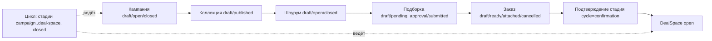

Факт: стадии цикла `COMMERCIAL_STAGES = campaign, collection, showroom, selection, order-builder, order, confirmation, deal-space`, плюс терминальное `closed` (`src/modules/commercial-cycle/public.mjs`, строки 3–12 и далее).

### 1.1 Кампания (`src/modules/campaigns/public.mjs`)

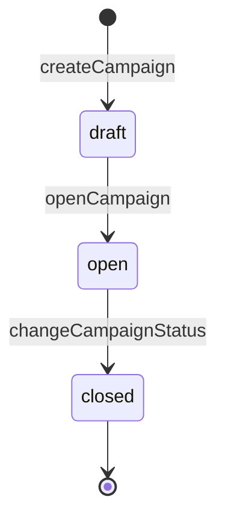

| Правило | Источник |
|---|---|
| Разрешены только `draft→open` и `open→closed`; всё остальное `CAMPAIGN_STATUS_TRANSITION_INVALID` | `changeCampaignStatus`, campaigns/public.mjs:24–31 |
| Даты: начало раньше конца (`CAMPAIGN_DATES_INVALID`) | там же, :9 |
| Способность `campaign.manage` у ролей owner/admin/sales бренда | `src/application/platform.mjs`, :151, :170, :192 |
| В HTTP есть только `POST /v2/campaigns` и `POST /v2/campaigns/:id/open`; перехода `open→closed` по HTTP нет | `src/http/routes.mjs`:93–94 (маршрута закрытия не найдено; функция домена есть) |

Запрещено: вернуть в `draft`, повторно открыть закрытую, добавить коллекцию в закрытую кампанию (`CAMPAIGN_CLOSED`, collections/public.mjs).

### 1.2 Коллекция (`src/modules/collections/public.mjs`)

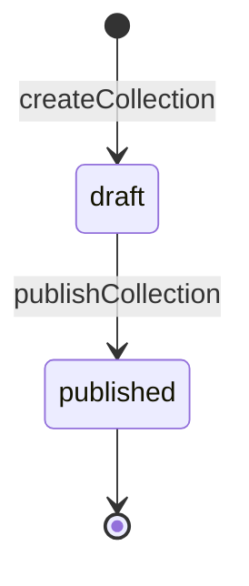

Правила: бренд коллекции равен бренду кампании; валюта ISO-4217 из трёх заглавных букв; публикация только из `draft` и только при открытой кампании (`CAMPAIGN_NOT_OPEN`); состав стилей (`collection_style_versions`, назначение версии стиля) меняется **только пока коллекция draft** (`COLLECTION_ASSORTMENT_LOCKED`). Обратного перехода `published→draft` нет. Назначение версий стилей неизменяемо на уровне БД (триггер на `collection_style_versions`, миграции).

### 1.3 Шоурум (`src/modules/showrooms/public.mjs`)

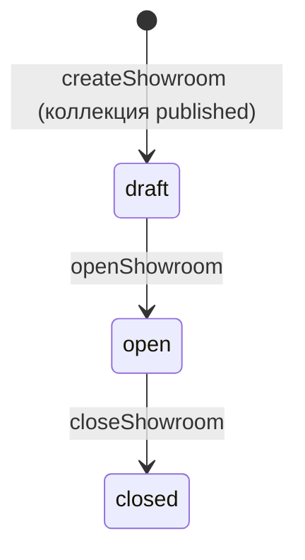

- Создать шоурум можно только на **опубликованной** коллекции (`COLLECTION_NOT_PUBLISHED`).
- Окно показа (`opensAt..closesAt`) отдельно от статуса: `showroomWindowState` возвращает `upcoming/running/elapsed`; подборку нельзя начать до начала и после конца окна, даже если бренд забыл нажать «Закрыть» (`assertShowroomWindowRunning`). Дата без времени в `closesAt` означает «весь день включительно по UTC».
- Открыть можно только `draft`, если окно не истекло.
- Поделиться (`showroom_invitations`) можно только открытым шоурумом.

Доступ магазина к шоуруму: приглашение (`pending→accepted/declined/revoked`) поверх **активной связи** бренд—магазин (`counterparty_relationships`).

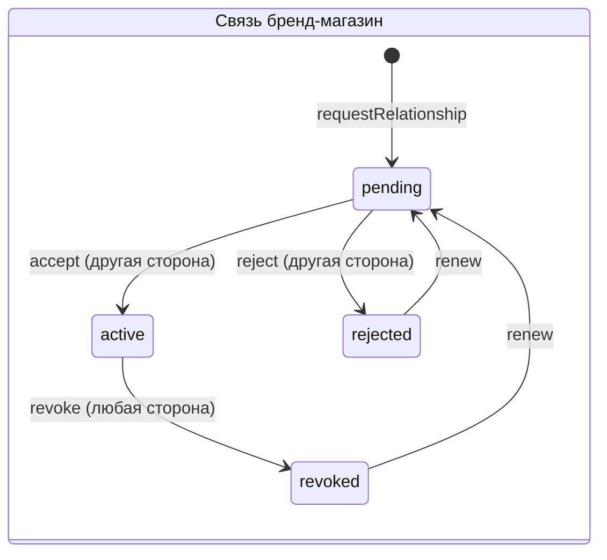

Факт: ответить на запрос связи не может тот, кто его создал (`RELATIONSHIP_SELF_RESPONSE_FORBIDDEN`), повторный запрос разрешён только из `rejected/revoked` (`RELATIONSHIP_NOT_RENEWABLE`), отзыв только из `active` (`src/modules/counterparty-relationships/public.mjs`:31–112).

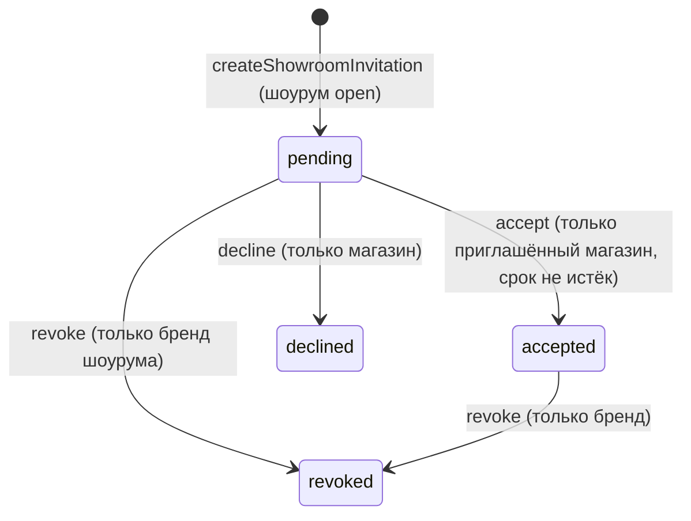

Источник: `src/modules/showroom-invitations/public.mjs`:10–128. Срок приглашения должен быть в будущем; принять просроченное нельзя (`SHOWROOM_INVITATION_EXPIRED`). Допуск к каталогу байера (`assertAcceptedShowroomAccess`) требует принятого приглашения и активной связи.

Образы шоурума (`showroom_looks`): позиция 1..500, от 1 до `MAX_PRODUCTS` товаров, один товар один раз, изображение только https-ссылка; в закрытый шоурум образы не добавляются (`SHOWROOM_CLOSED`); правка по `expectedVersion` (`SHOWROOM_LOOK_CONCURRENCY_CONFLICT`) (`src/modules/showroom-looks/public.mjs`).

### 1.4 Подборка (`src/modules/selections/public.mjs`)

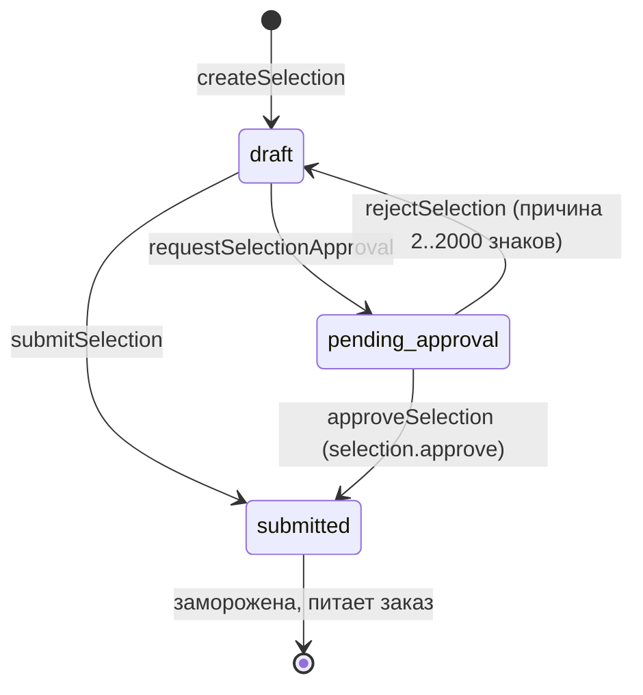

Условия и запреты (факт):

| Правило | Код |
|---|---|
| Создание: цикл на стадии `showroom`, шоурум `open`, окно показа идёт, коллекция и бренд совпадают с циклом | `SELECTION_CYCLE_STAGE_INVALID`, `SHOWROOM_NOT_OPEN`, `SHOWROOM_WINDOW_*` |
| Строки правятся только в `draft` | `SELECTION_NOT_DRAFT` |
| Отправка и запрос согласования: минимум одна строка и **одна валюта** на все строки | `SELECTION_LINES_REQUIRED`, `SELECTION_CURRENCY_MISMATCH` |
| Количество целое ≥ 1, цена как деньги в минимальных единицах, валюта ISO | `normalizeSelectionLine` |
| «Богатая» строка требует полного происхождения (productSku, style, styleVersion, colorway, sizeValue, sizeCode, порядок размера), иначе `SELECTION_LINE_LINEAGE_INCOMPLETE` | selections/public.mjs |
| Коммерческая основа подборки: только опубликованный каталог байера (`BuyerCatalogVersion`) того же шоурума, бренда, магазина, коллекции; «богатый» каталог обязан нести полное происхождение неизменяемой коммерческой проекции | `validateCommercialBasis`, `SELECTION_COMMERCIAL_*` |
| Контекст розничной точки (`retailDoor`) можно закрепить только вместе с каталогом байера | `SELECTION_RETAIL_DOOR_REQUIRES_BUYER_CATALOG` |
| Согласует не тот, кто собирал: `selection.write` у buyer, `selection.approve` у finance | `src/modules/access-control/public.mjs` (комментарий про разделение обязанностей) |

Запрещено: редактировать `submitted`, вернуть `submitted→draft`, согласовать подборку не из `pending_approval`.

### 1.5 Заказ (`src/modules/orders/public.mjs`, `order-commit`, `order-amendments`)

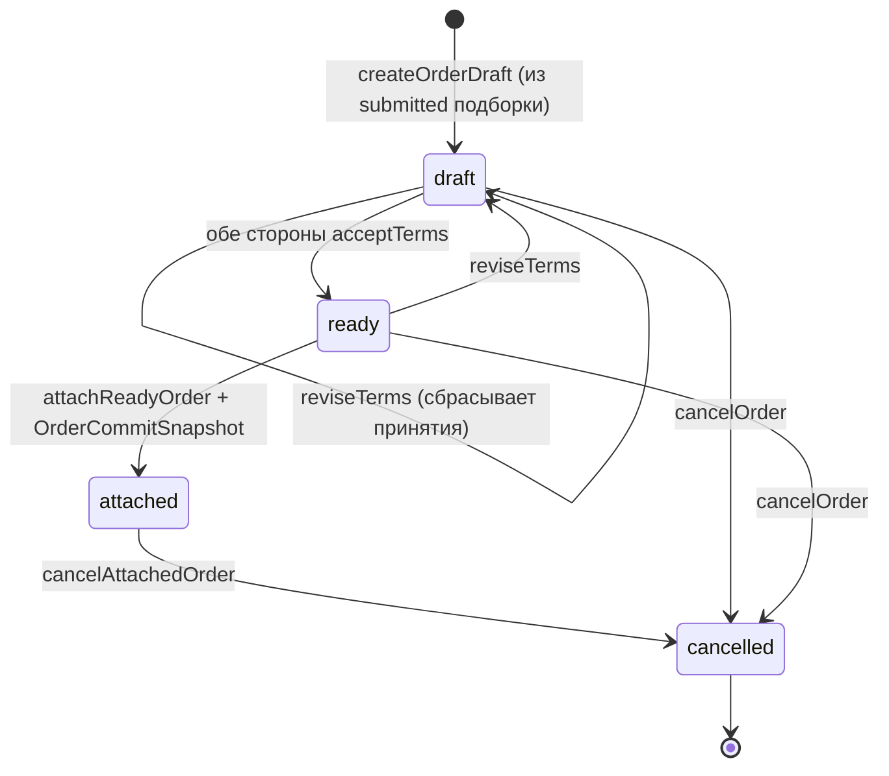

| Правило | Источник |
|---|---|
| Заказ создаётся только из `submitted` подборки; валюта заказа равна замороженной валюте подборки | orders:12–15 |
| Условия (Incoterm из списка, `paymentDays` 0..365, предоплата 0..100%, окно поставки упорядочено) правятся только в `draft/ready`; правка **сбрасывает принятия** и возвращает в `draft` | `reviseOrderTerms`, :79–92 |
| Принимать условия могут только стороны заказа (бренд или магазин); обе приняли → `ready` | `acceptOrderTerms`, :94–110 |
| `attached` только из `ready`; одновременно создаётся неизменяемый `OrderCommitSnapshot` | `attachReadyOrder`, :112 |
| Отмена: из `draft/ready/attached`, причина 3..N знаков; из `cancelled` отмены нет | `cancelOrder`, :144 |
| Любая правка проверяет `expectedVersion` (оптимистичная блокировка) | `assertExpectedVersion` |

Цикл знает о заказе так: `attachOrder` в цикле возможен только на стадии `order`, при `order.status=attached`, положительном итоге, итог строк сходится с итогом заказа с точностью 1e-6 (`ORDER_TOTAL_MISMATCH`), валюта заказа равна валюте коллекции (`platform.mjs`:628–636).

**Правки заказа после фиксации** (`order_amendments`): `proposed → accepted | rejected`. Предложить можно только изменение количества одной строки (число должно отличаться от текущего); ответить не может предложившая сторона (`ORDER_AMENDMENT_SELF_RESPONSE_FORBIDDEN`); применить можно только принятую правку к заказу в `attached`, если количество строки не менялось с момента предложения (`ORDER_AMENDMENT_STALE`). После применения создаётся **новая ревизия** `OrderCommitSnapshot` (`reviseOrderCommitSnapshot`): старая остаётся «как подтверждено первый раз», меняются только количества и итог; SKU, цены, условия, набор строк менять нельзя (`ORDER_COMMIT_REVISION_LINES_CHANGED`, `..._TERMS_CHANGED`).

### 1.6 Подтверждение и сделка (`commercial-cycle`, `deal-space`)

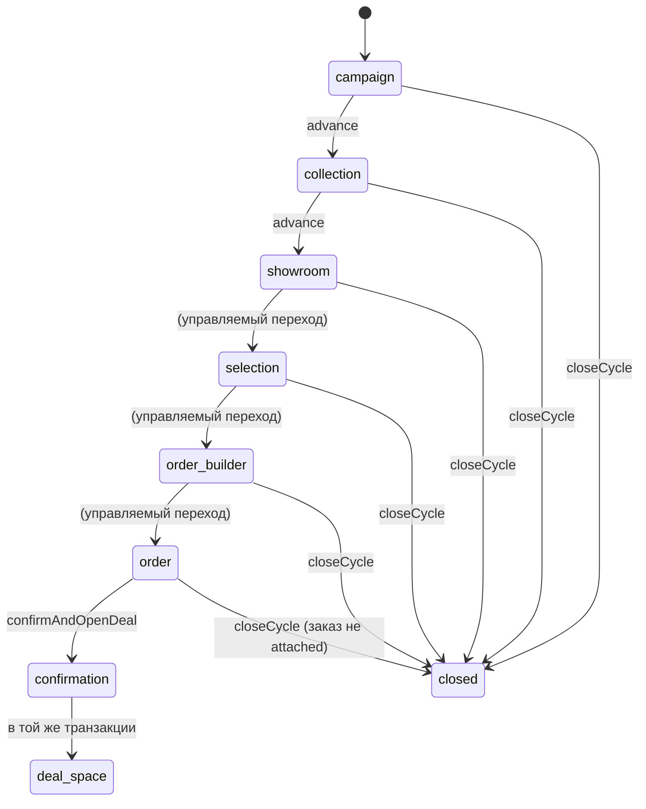

Подписи: `order_builder` = стадия `order-builder`; `deal_space` = `deal-space`.

Факт (`commercial-cycle/public.mjs`, `platform.mjs`):

- Стадии идут **только вперёд на один шаг** (`STAGE_TRANSITION_INVALID`).
- По HTTP-команде `advance` можно двигать только `campaign` и `collection`; остальные переходы только «своим» рабочим процессом (`CYCLE_MANAGED_TRANSITION_REQUIRED`, platform.mjs:~556).
- В `confirmation` можно только с прикреплённым (`attached`) заказом и положительным итогом.
- Подтверждение блокируется, пока есть неотвеченная правка количества (`CYCLE_CONFIRMATION_AMENDMENT_PENDING`).
- `confirmAndOpenDeal` за **одну транзакцию**: стадия `confirmation`, затем `DealSpace` (`status=open`), затем стадия `deal-space`, два календарных события «сделка открыта» (по одному для бренда и магазина), события `order.confirmed` и `deal-space.opened`.
- Закрыть цикл (`closeCycle`) нельзя на `confirmation`, `deal-space` и повторно (`CYCLE_CLOSE_STAGE_INVALID`, `CYCLE_ALREADY_CLOSED`): подтверждённый цикл это сделка, а не брошенная попытка. Нельзя закрыть цикл с прикреплённым заказом: сначала явная отмена заказа, потому что резервы склада снимает только она (`CYCLE_CLOSE_ORDER_ATTACHED`). Заказ в `draft/ready` отменяется вместе с циклом. Причина закрытия 3..1000 знаков, обязателен `expectedVersion`.
- `DealSpace` у `openDealSpace` создаётся только из цикла на `confirmation` с заказом. Статус сделки в коде один: `open` (дальнейших состояний сделки в `src/modules/deal-space/public.mjs` нет, 17 строк).
- Старт цикла требует обеих организаций нужных типов (бренд, магазин, не одна и та же), способности `commercial-cycle.create` у участника, **активной связи** бренд—магазин, открытой кампании и опубликованной коллекции этой кампании.

### 1.7 Таблица запрещённых переходов (сводка)

| Сущность | Запрещено | Код отказа |
|---|---|---|
| Кампания | `draft→closed`, `closed→*`, `open→draft` | `CAMPAIGN_STATUS_TRANSITION_INVALID` |
| Коллекция | повторная публикация; правка состава после публикации | `COLLECTION_ALREADY_PUBLISHED`, `COLLECTION_ASSORTMENT_LOCKED` |
| Шоурум | открыть не-`draft`; закрыть не-`open`; открыть после окончания окна | `SHOWROOM_NOT_DRAFT`, `SHOWROOM_NOT_OPEN`, `SHOWROOM_WINDOW_ELAPSED` |
| Подборка | править/отправлять не-`draft`; согласовать не из `pending_approval`; смешать валюты | `SELECTION_NOT_DRAFT`, `SELECTION_NOT_PENDING_APPROVAL`, `SELECTION_CURRENCY_MISMATCH` |
| Заказ | править условия после `attached`; прикрепить без обоих принятий; отменить `cancelled` | `ORDER_TERMS_NOT_EDITABLE`, `ORDER_NOT_READY`, `ORDER_NOT_CANCELLABLE` |
| Цикл | шаг через стадию; движение закрытого; закрытие после подтверждения | `STAGE_TRANSITION_INVALID`, `CYCLE_CLOSED`, `CYCLE_CLOSE_STAGE_INVALID` |
| Правка заказа | ответ самим предложившим; применение к устаревшей строке | `ORDER_AMENDMENT_SELF_RESPONSE_FORBIDDEN`, `ORDER_AMENDMENT_STALE` |

## 2. PLM-контур: от стиля до готовности к продаже

### 2.1 Жизненный цикл стиля (`src/modules/product-identity/public.mjs`:22–101)

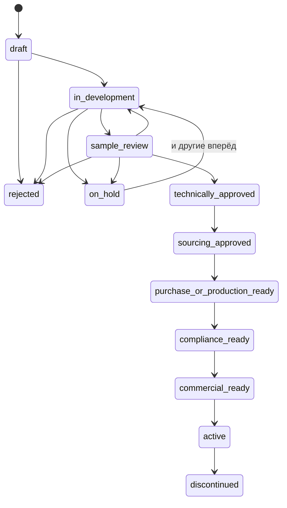

Из `technically_approved … active` в каждом состоянии разрешены ещё `on_hold` и `superseded`; из `on_hold` можно в любое рабочее состояние, `discontinued`, `rejected`, `superseded`. Терминальные: `discontinued`, `rejected`, `superseded` (переходов нет). Карту отдаёт `allowedStyleTransitions` и `styleLifecycleMap`, чтобы экран предлагал ровно то, что разрешает домен.

**Ворота готовности.** Состояния `commercial_ready` и `active` (`READINESS_GATED_STYLE_STATUSES`) не ставятся «на слово»: переход опирается на последнюю оценку готовности этой модели (раньше модель с заблокированными измерениями переводилась одним нажатием, как сказано в комментарии кода).

### 2.2 Готовность (`src/modules/product-readiness/public.mjs`)

Оценка готовности собирается из **размерностей** (`dimensions`), каждая `ready / blocked / not_applicable`. Найденные коды: `product_identity`, `category`, `colorways`, `size_scale`, `sku_matrix`, `measurements`, `product_attributes`, `bom`, `samples`, `tech_pack`, `sourcing`, `purchase_or_production_commitment`, `quality`, `commercial_content`, `commercial_media`, `commercial_terms`, `availability_delivery` (17). Итог `ready`, только если нет ни одной `blocked` (:237). Условия технических размерностей (:137–197): BOM опубликован; образец одобрен и типа `pre-production`; техпак в статусе `acknowledged`; сорсинг `allocated`; производственный заказ `confirmed`; качество `released`.

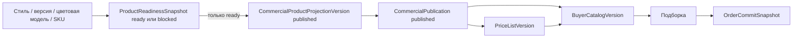

Запрет: проекция из не-`ready` оценки отклоняется кодом `COMMERCIAL_PROJECTION_READINESS_BLOCKED` (HTTP 422; это проверяет живая приёмка `acceptance:product-readiness`). Единственный допустимый путь от техники к торговле это `ProductReadinessSnapshot → CommercialProductProjectionVersion → CommercialPublication` (`docs/commercial-execution-spine.md`).

### 2.3 Цепочка разработки и производства

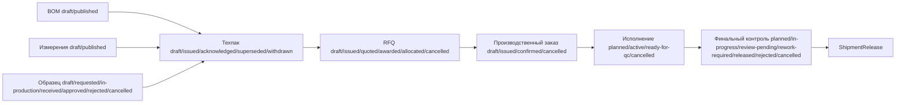

Ключевые запреты (факт из `src/modules/*/public.mjs`):

| Автомат | Запрещено | Источник |
|---|---|---|
| Образец | запросить не-`draft`; одобрить/отклонить не-`received`; следующий раунд не из `rejected`; запрос только для опубликованного SKU | samples/public.mjs:45–119 |
| Техпак | править не-`draft`; подтвердить не-`issued`; выпустить без опубликованных SKU, BOM, измерений и одобренного образца | tech-packs/public.mjs:36–132 |
| RFQ | цена из неквалифицированного поставщика; присудить без котировки; распределить не-`awarded`; отменить `allocated` | sourcing/public.mjs:115–463 |
| Производственный заказ | выпустить не-`draft`; подтвердить не-`issued`; отменить после `confirmed`; создать из неаллоцированного RFQ или неквалифицированного поставщика | production-orders/public.mjs:54–119 |
| Исполнение | старт без подтверждённого поставщиком заказа; веха выполняется только при `active`; отмена `ready-for-qc` при живой инспекции | production-execution/public.mjs:13–133 |
| Финальный контроль | создание только из исполнения `ready-for-qc` со всеми вехами `completed` | final-quality/public.mjs |
| Поставщик | редактировать/квалифицировать только `draft/suspended`; архивировать квалифицированного нельзя (сначала `suspended`) | sourcing/public.mjs:41–80 |

Разделение обязанностей: `quality.approve` есть у `quality`, owner, admin; у `sales` и `production` его нет (только чтение качества). Это закреплено в комментариях таблицы ролей.

## 3. Оркестрация пересчётов (`recompute-orchestration`)

Источник: `docs/architecture/product-engineering-recompute-orchestration.md` (статус в документе: Tranche A IMPLEMENTED, B1 IMPLEMENTED/PARTIAL), `src/modules/product-engineering/recompute-orchestration.mjs`, `src/application/product-engineering-recompute-orchestration-service.mjs`, миграции с таблицами `product_engineering_*`.

Зачем: подтверждённая правка изделия может обесценить уже «замороженные» снимки ниже по цепочке. Оркестратор фиксирует точный набор устаревшего, исполняет детерминированный граф и закрывает допуск только когда всё доказано. Он **не универсальный писатель** в чужие контексты.

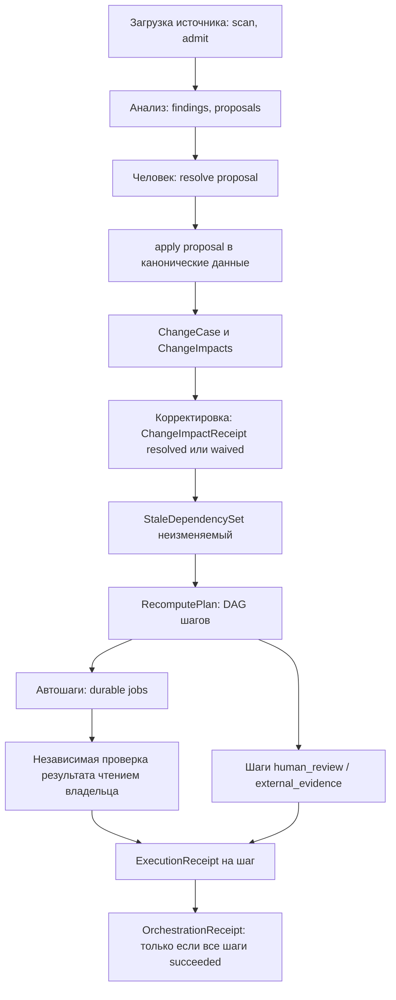

Инварианты (все из документа и кода):

1. Набор устаревшего строится только из **наблюдаемых версионных рёбер** вызывающего, а не из эвристик по именам (`createStaleDependencySet`: триггер должен быть `resolved`, с проверенным результатом и хэшами SHA-256).
2. План детерминирован: уровни топологической сортировки канонические, внутри уровня сортировка по id; повтор не зависит от порядка входа.
3. У шага режим `automatic | human_review | external_evidence`, серьёзность `medium | high | blocking`. Статуса исполнения в строке шага нет: правда это журнал квитанций плюс очередь.
4. Работники берут только `automatic`; задание берётся, когда у **всех** родителей есть успешная квитанция; аренда с истечением и перезахват после падения процесса; ограниченные повторы с экспоненциальной задержкой; терминальный dead letter. Семантика очереди `FOR UPDATE SKIP LOCKED`.
5. Диспетчер по белому списку `<authority>:<operation>`; неизвестная пара отказ `PRODUCT_ENGINEERING_RECOMPUTE_OPERATION_UNSUPPORTED`. Найдены адаптеры: `material.verify_published_revision`, `measurement.verify_published_revision` (файлы `product-engineering-material-recompute-adapter.mjs`, `product-engineering-measurement-recompute-adapter.mjs`).
6. Успех автошага требует точной канонической ссылки результата и независимой проверки; успех ручного шага требует явного доказательства.
7. Запись квитанции и завершение задания в **одной транзакции PostgreSQL**; план, шаги, наборы, квитанции от UPDATE/DELETE защищены триггерами БД.
8. Исчерпание повторов не «изображает» исправление: допуск остаётся ложным.

Чего **нет** (по документу, статус B1): регистрации воркера пересчёта на сервере в полном объёме, конкретных адаптеров Cost/Readiness/Commercial/Tech Pack, HTTP/OpenAPI маршрутов оркестратора, проекции в Awaiting Action для ручных шагов, внешней приёмки доказательств, воспроизведения заблокированного действия, интеграции с метриками, живого сквозного прогона. В окружении есть флаги `SYNTHA_ENGINEERING_MATERIAL_RECOMPUTE_ENABLED` и `SYNTHA_ENGINEERING_MEASUREMENT_RECOMPUTE_ENABLED` (названия найдены в `src/runtime`, значения не читались).

### 3.1 ИИ-слой: что разрешено

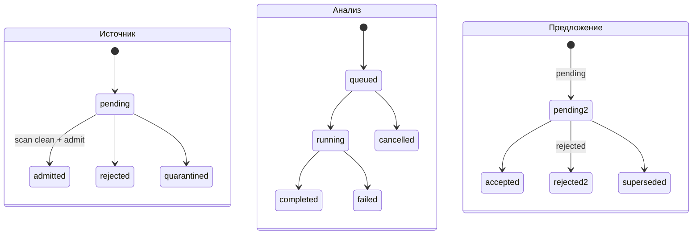

Факт: `ENGINEERING_SOURCE_STATUSES = pending, admitted, rejected, quarantined`; `ANALYSIS_STATUSES = queued, running, completed, failed, cancelled`; `PROPOSAL_STATUSES = pending, accepted, rejected, superseded`. ChangeCase: `open → acknowledged → resolved`; ChangeImpact: `pending → resolved | waived` (`change-impact.mjs`:109–211). Загрузка файла: до 20 МБ, типы pdf/xlsx/csv/jpeg/png/webp/svg, проверка сигнатуры, расширения и SHA-256, хранение байтов в PostgreSQL (`source-upload.mjs`). Модель ИИ запускается только как квалифицированная (`QUALIFICATION_STATUSES = qualified/suspended/retired`, `model-control.mjs`) и пишет **предложения**, а не мастер-данные: применение идёт через `product-engineering-proposal-apply-service.mjs` после решения человека (см. также `README.md` проекта).

## 4. Неизменяемые снимки

В БД триггеры запрещают UPDATE/DELETE (названия `*_immutable`, `*_no_update`, `reject_*_mutation`) у таблиц: `order_commit_snapshots` (плюс «охранник ревизий»), `commercial_publications`, `price_list_versions`, `buyer_catalog_versions`, `commercial_product_projection_versions`, `product_readiness_snapshots`, `collection_style_versions`, `supply_commitment_snapshots`, `fulfillment_plan_snapshots`, `shipment_notice_snapshots`, `receipt_snapshots`, `receipt_discrepancy_snapshots`, `receipt_discrepancy_claim_snapshots`, `receipt_claim_resolution_snapshots`, `supplier_claim_recovery_snapshots`, `actual_cost_ledger_entries`, `landed_cost_snapshots`, `margin_actualization_snapshots`, `cost_allocation_policy_versions`, `cost_allocation_run_snapshots`, `cost_close_snapshots`, `cost_close_readiness_snapshots`, `post_close_adjustments`, `post_close_allocation_reconciliation_snapshots`, `order_fx_rate_snapshots`, `inventory_movement_ledger_entries`, `production_requirement_snapshots/lines`, `quality_inspections` (исходные поля), `quality_shipment_releases`, `legal_entity_versions`, `mdm_*_versions`, `mdm_usage_snapshots`, `operational_exception_transitions`, `product_engineering_stale_dependency_sets`, `..._recompute_plans`, `..._plan_steps`, `..._execution_receipts`, `..._orchestration_receipts`. Найдено поиском `CREATE TRIGGER`/`ON <таблица>` по `db/migrations/`; **отдельно триггер на каждую таблицу не перепроверялся построчно**.

Принципы (из `docs/commercial-execution-spine.md`):

- Покупатель видит цену, MOQ и варианты только из неизменяемых `CommercialPublication / PriceListVersion / BuyerCatalogVersion`, не из изменяемых PLM-полей.
- `OrderCommitSnapshot` единственная замороженная правда сделки для физики и экономики; исправления только новой ревизией.
- Физическая идентичность строки это пара `orderLineNo + productSkuId`; текстовый `sku` для показа и совместимости.
- Исправления себестоимости: добавление сторнирующей и заменяющей записи, не правка (`actual-cost.corrected`, `actual-cost.reversed`).
- Закрытие себестоимости (`CostCloseSnapshot`) не переписывается поздними затратами; поздние идут через `PostCloseAdjustment` и новые снимки.
- Откат каталога байера (`rollbackBuyerCatalog`) делает **новую** версию, не удаляет старую (событие `buyer-catalog-version.rolled-back`).

## 5. Идемпотентность и конкурентность

- Каждая мутация по HTTP требует заголовок `Idempotency-Key`; для запросов без него `requireIdempotencyKey` отказывает (`src/http/pipeline.mjs`: `route.mutation ? requireIdempotencyKey(...)`; исключение: вход и принятие приглашения).
- Ключ записывается в реестр `command_registry` и журнал команд своего контекста (`src/infrastructure/postgres-command-registry.mjs`: 12 журналов, среди них `commands`, `catalog_commands`, `product_identity_commands`, `product_engineering_commands`, `operational_exception_commands`). Повтор с тем же ключом и тем же отпечатком возвращает прежний результат; **тот же ключ в другой области** отказ `COMMAND_SCOPE_CONFLICT`; разошедшиеся реестр и журнал `COMMAND_LEDGER_INCONSISTENT`.
- Отпечаток команды строится из актёра, операции и канонического JSON входа (`execute(commandId, fingerprint, actorId, ...)` в `platform.mjs`).
- Изменяющие сущности используют `expectedVersion` (поле `version` растёт на 1): отказ `*_CONCURRENCY_CONFLICT`, HTTP 409; на экране это «данные изменились, обновить» (`DESIGN.md`).
- Событие домена пишется в той же транзакции, что и изменение (`append(tx, 'order.confirmed', ...)`), затем outbox публикует во внешний вебхук с подписью HMAC-SHA256 и заголовком `Idempotency-Key = id события` (`src/infrastructure/http-outbox-publisher.mjs`). Есть dead letter и команда повторной постановки (`scripts/requeue-outbox-event.mjs`).
- Все мутации списываются в одну транзакцию с блокировкой по команде (`lockCommand`), поэтому двойной клик не создаёт два заказа.

## 6. Изоляция организаций (бренд и магазин)

Тип организации только `brand` или `shop`, и они должны различаться (`assertTradePair`). Фабрика и поставщик не организации, а **контрагенты и портал поставщика** (`suppliers`, `supplier_portal_grants`).

Слои защиты (факт):

1. **Членство и способности.** Любая мутация идёт через `assertOrganisationActor / authorizeTrade` с проверкой активного членства и способности (`access-control/public.mjs`, 68 способностей). Отключённое членство не даёт доступа (`ACTIVE_MEMBERSHIP_REQUIRED`).
2. **Область видимости чтения.** `loadPostgresVisibilityScope` (`src/infrastructure/postgres-visibility-scope.mjs`) собирает по активным членствам пользователя: свои организации, бренды, организации-контрагенты через связи, кампании и коллекции из своих циклов, шоурумы из своих приглашений, подборок и шоурумы своих брендов. Читатели рабочего места отбирают строки по этой области.
3. **Скрытие стоимости.** Поля с именами `cost` / `margin` (регулярное выражение `/cost|margin/i`) физически убираются из ответа для ролей без `cost.manage` или `margin.read` (`cost-visibility.mjs`, принцип A-02). Поле не обнуляется, а исчезает.
4. **Разделение сторон сделки.** Заказ принимают только его стороны; ответ на правку и на связь не может дать инициатор; приём приглашения только приглашённым магазином, отзыв только брендом шоурума.
5. **Портал поставщика отделён** отдельной таблицей допусков и триггером `supplier_portal_grants_separation`; маршруты `/v2/supplier-portal/*`.
6. **Команда.** Владельца назначает только владелец; последнего владельца нельзя понизить или отключить; роль можно сменить себе только вниз (`team-membership/public.mjs`, коды `TEAM_LAST_OWNER`, `TEAM_OWNER_ROLE_RESERVED`, `TEAM_SELF_ROLE_ESCALATION`, `TEAM_SELF_DEACTIVATION` из `ARCHITECTURE.md`:363).
7. Составные внешние ключи с `brand_id` у продуктовых таблиц (например, у оркестратора: «каноническое составное FK ProductStyle», документ оркестрации).

Важное уточнение имён: скрипт `npm run validate:isolation` (`scripts/validate-isolation.mjs`) проверяет **изоляцию репозитория от прежнего проекта** (запрещённые строки), а не изоляцию арендаторов. Доказательство межарендной изоляции живыми запросами по данным репозитория отсутствует: `docs/audit-2026-09-21.md` (по пакету `02`) говорит, что на одной паре «бренд—магазин» её не удалось доказать; в `ARCHITECTURE.md`:2317 изоляция названа обязательным элементом будущей приёмки. Считать утверждение «изоляция подтверждена» нельзя.

## 7. Рабочие места ролей: кто что видит

Рабочее место загружается одним запросом `GET /v2/workspace` (и постранично `GET /v2/workspace/:section/page`) и содержит разделы: `memberships, organisations, relationships, invitations, campaigns, collections, productStyles, placeholders, colorways, media, catalogSkus, showrooms, cycles, selections, orders, deals, calendar` (`src/application/workspace-query-service.mjs`, `SORT_FIELDS`). Навигация сайдбара фиксирована: Обзор; Разработка → Каталог; Оптовая коммерция → Шоурумы, Партнёры, Подборки, Заказы; Управление → Календарь, Уведомления (`public/modules/app-core.js`:5–17). Остальные PLM-экраны (стили, материалы, BOM, измерения, образцы, сорсинг, техпаки, производство, качество, экономика) открываются внутри этих разделов и через «Ожидает действия» (`awaiting-action.js`, `workspace-hub.js`). Кнопки показываются по способностям роли (`ui-capabilities.js`: `hasAny`, `hasForOrganisation`).

| Роль | Организация | Что видит и делает (по способностям) | Чего не видит и не может |
|---|---|---|---|
| owner, admin | бренд или магазин | все 68 способностей, включая команду и организацию | owner отличается от admin только «последней инстанцией»: роль owner назначает только owner |
| sales | бренд | кампании, коллекции, каталог, стили и инжиниринг (чтение и ведение), шоурум, связи, приглашения, цикл, заказ и подтверждение, поставка (ведение), претензии (решение), маржа (чтение), сделка, переписка и решения | BOM и измерения только на чтение; не одобряет качество; не ведёт себестоимость; не ведёт сорсинг и техпак |
| production | бренд | инжиниринг (ведение), техпак (ведение), сорсинг (ведение), распределение, закупка материалов, производственные заказы и исполнение, склад материалов | не подтверждает качество; не видит маржу и себестоимость (ни `cost.manage`, ни `margin.read`) |
| quality | бренд | качество (ведение и одобрение), сертификация продукта (ведение), чтение остального техпроцесса | не продаёт, не заказывает, не ведёт каталог |
| finance | бренд или магазин | себестоимость и маржа, платежи, документы соответствия (ведение), согласование подборки (`selection.approve`), подтверждение заказа | не пишет заказ (`order.write` нет), не ведёт каталог |
| buyer | магазин | связи, принятие приглашений, торговые точки, подборка (запись), цикл, заказ и подтверждение, приёмка, склад, претензии (подача) | не видит себестоимость бренда; не согласует собственную подборку |
| viewer | любая | 8 способностей чтения: продукт, торговые точки, склад, претензии, сделка, переписка, исключения, календарь | любая запись |

Полная матрица способностей по разделам (генерируется из таблицы `ROLE_CAPABILITIES`):

| Раздел (способности) | owner/admin | sales | production | quality | buyer | finance | viewer |
|---|---|---|---|---|---|---|---|
| Кампании/коллекции (`campaign.manage`, `collection.manage`, `catalog.manage`) | ● | ● | ○ | ○ | ○ | ○ | ○ |
| Продукт (чтение/ведение) (`product.read`, `product.manage`) | ● | ● | ◐ read | ◐ read | ○ | ◐ read | ◐ read |
| Инжиниринг продукта (ИИ-разбор) (`product-engineering.read`, `product-engineering.manage`) | ● | ● | ● | ◐ read | ○ | ○ | ○ |
| BOM (`bom.read`, `bom.manage`) | ● | ○ | ◐ read | ◐ read | ○ | ◐ read | ○ |
| Измерения (`measurement.read`, `measurement.manage`) | ● | ◐ read | ◐ read | ◐ read | ○ | ○ | ○ |
| Образцы (`sample.read`, `sample.manage`) | ● | ◐ read | ◐ read | ◐ read | ○ | ○ | ○ |
| Техпак (вести/подтвердить) (`tech-pack.manage`, `tech-pack.acknowledge`) | ● | ○ | ◐ manage | ○ | ○ | ○ | ○ |
| Сорсинг (вести/присудить) (`sourcing.manage`, `sourcing.award`) | ● | ○ | ◐ manage | ○ | ○ | ○ | ○ |
| Производственные заказы (вести/подтвердить) (`production-order.manage`, `production-order.confirm`) | ● | ◐ manage | ◐ manage | ○ | ○ | ○ | ○ |
| Качество (вести/одобрить) (`quality.manage`, `quality.approve`) | ● | ○ | ○ | ● | ○ | ○ | ○ |
| Шоурум и партнёры (`showroom.manage`, `partner-relationship.manage`, `showroom-invitation.manage`, `showroom-invitation.accept`) | ● | ◐ manage, manage, manage | ○ | ○ | ◐ manage, accept | ○ | ○ |
| Подборка (писать/согласовать) (`selection.write`, `selection.approve`) | ● | ○ | ○ | ○ | ◐ write | ◐ approve | ○ |
| Цикл (создать/продвинуть) (`commercial-cycle.create`, `commercial-cycle.advance`) | ● | ● | ○ | ○ | ● | ○ | ○ |
| Заказ (писать/подтвердить) (`order.write`, `order.confirm`) | ● | ● | ○ | ○ | ● | ◐ confirm | ○ |
| Поставка/приёмка/склад (`fulfillment.manage`, `receipt.manage`, `inventory.manage`) | ● | ◐ manage | ◐ manage | ○ | ◐ manage, manage | ○ | ○ |
| Претензии (вести/решить) (`claim.manage`, `claim.resolve`) | ● | ◐ resolve | ○ | ○ | ◐ manage | ○ | ○ |
| Себестоимость / маржа (`cost.manage`, `margin.read`) | ● | ◐ read | ○ | ○ | ○ | ● | ○ |
| Сделка (чтение) (`deal.read`) | ● | ● | ○ | ○ | ● | ● | ● |
| Исключения (вести) (`exception.manage`) | ● | ● | ● | ● | ● | ● | ○ |
| Документы соответствия (вести) (`compliance-document.manage`) | ● | ○ | ○ | ○ | ○ | ● | ○ |
| Сертификация продукта (вести) (`product-certification.manage`) | ● | ○ | ○ | ● | ○ | ○ | ○ |
| Команда / организация (`membership.manage`, `organisation.manage`) | ● | ○ | ○ | ○ | ○ | ○ | ○ |

Легенда: ● все способности группы, ◐ часть (перечислена), ○ нет. Колонка owner/admin одинакова (все 68).

Особенности, на которые стоит смотреть при приёмке:

- У `finance` есть `order.confirm`, но нет `order.write`: подтвердить можно, создать заказ нельзя.
- У `sales` есть и `order.write`, и `order.confirm` в бренде; у `buyer` те же в магазине. Подтверждение двустороннее: обе стороны принимают условия заказа (`acceptOrderTerms`), и только затем заказ становится `ready`.
- Роль `viewer` магазина и бренда одинакова по набору, различается область данных.
- Для магазина допустимые роли: `owner, admin, buyer, finance, viewer`; для бренда: `owner, admin, sales, production, quality, finance, viewer` (`ALLOWED_ROLES`).
- Роли «технолог», «конструктор», «менеджер» в оркестраторе (назначения человека на шаг пересчёта) в таблице ролей **отсутствуют**: в `ARCHITECTURE.md`:2313 они названы «явными назначениями», проекция в «Ожидает действия» не реализована (B2). Это пробел, а не готовая функция.

## 8. Связь с MDM и справочниками

Каталог `mdm/` содержит источник правды для справочников: `catalog/*.json` (5 файлов), `reference/russia-fashion-*.json` (6 наборов: ассортимент, цвет, конструкция, волокно, измерения, ядро), `attributes/attribute-catalog.json`, схемы JSON, `sources/source-registry.json`, `generated/source-state.json`, `CHANGELOG.md`. Загрузка в БД: `scripts/bootstrap-mdm-reference.mjs` (идемпотентно), синхронизация источников `scripts/sync-mdm-sources.mjs`, проверка `npm run validate:mdm`, порог покрытия `ops/mdm-coverage-baseline.json`.

В БД: `mdm_dictionaries`, `mdm_entries` с версиями (`mdm_dictionary_versions`, `mdm_entry_versions`), запрет UPDATE версий и DELETE, `mdm_change_requests`, `mdm_usage_snapshots` (снимок «где использован», неизменяем), `mdm_source_states`, события в outbox. Экран «Справочники» читает `GET /v2/libraries` и `/v2/libraries/:id/entries` (`libraries.js`); формы стиля, материала и палитры берут цвет и конструкцию оттуда (`/v2/libraries/colour.colour/entries`, `design.construction_node`). Готовность «категория» и «измерения» опираются на точные версии записей справочников (`APPAREL`, `INT_ALPHA`, `INT_M`, `CM`, `CHEST_CIRC` в описании приёмки, `ARCHITECTURE.md`:567). Валюты: `currency_reference_rates` из курса ЦБ РФ (`scripts/sync-cbr-rates.mjs`: USD, EUR, CNY, TRY, JPY к RUB) и сезонные курсы `season_fx_rates`.

## 9. Ключевые инварианты: что нельзя ломать

| № | Инвариант | Чем защищён | Что будет при поломке |
|---|---|---|---|
| I1 | Цена и количество в заказе берутся из замороженной подборки и каталога, не из изменяемых полей | снимки + триггеры + `assertBuyerCommercialSnapshot` | байер видит одну цену, платит другую |
| I2 | Цикл идёт на один шаг вперёд, подтверждённый не закрывается | `advanceCommercialCycle`, `closeCommercialCycle` | сделки «бросают», резервы склада зависают |
| I3 | Подтверждение + открытие сделки + календарь в одной транзакции | `confirmAndOpenDeal` | цикл в `confirmation` без сделки |
| I4 | Согласует не тот, кто собирал | роли `selection.write` / `selection.approve` | обход внутреннего контроля магазина |
| I5 | Качество подписывает не тот, кто продаёт | `quality.approve` только у quality | отгрузка негодной партии |
| I6 | Себестоимость и маржа не покидают роли с доступом | `withholdCostFields` | утечка закупочной цены байеру |
| I7 | Мутация идемпотентна и версионирована | `Idempotency-Key`, `expectedVersion` | двойные заказы, потерянные правки |
| I8 | Исправление = новая запись, а не правка | триггеры immutability, `reviseOrderCommitSnapshot` | пропадает аудит |
| I9 | Не-`ready` оценка не превращается в коммерческую проекцию | `COMMERCIAL_PROJECTION_READINESS_BLOCKED` | в продажу уходит неготовое изделие |
| I10 | Пересчёт закрывается только после независимой проверки владельцем | `RecomputeOrchestrationReceipt` | ложное «всё актуально» |
| I11 | ИИ пишет предложения, применяет человек | `proposal-apply-service` | ИИ меняет мастер-данные |
| I12 | Миграции не правятся задним числом | контрольные суммы + advisory lock (`postgres-migrator.mjs`) | расхождение схем между средами |
| I13 | Отмена заказа снимает резерв склада | триггер `orders_release_inventory_on_cancel` | «вечные» резервы |
| I14 | Фабрика и портал отделены от бренда и магазина | `supplier_portal_grants_separation` | утечка данных брендов поставщику |

Перед изменением любого пункта: найти тесты по имени кода отказа (`tests/`), добавить тест на новое поведение и обновить `ARCHITECTURE.md`, `docs/business/04-interface-and-connections.md`.

## Что осталось неподтверждённым

- Ни один сценарий не запускался; автоматы выведены чтением доменных модулей. Состав переходов в СУБД (триггеры, CHECK) для каждой таблицы не сверялся построчно.
- Не подтверждено, что `open→closed` кампании и закрытие шоурума/цикла доступны с экрана: по HTTP найден `showrooms/:id/close` и `cycles/:id/close`, для кампании маршрут закрытия не найден.
- Не проверены тесты на изоляцию арендаторов и их результат.
- Статусы оплат поставщикам (`planned/due/overdue/paid`), претензий, стоимости и закрытия периода описаны только перечнями, детальные автоматы не разбирались.
- Роли оркестратора (технолог/конструктор) и их маршрутизация не реализованы по документу, реальный путь ручного шага не проверялся.

## Расхождения с пакетом 01–03

- `01-business-plan.md` и `02-detailed-analysis.md` говорят о «21 CSS-файле в `public/index.html`»: подтверждено, но в каталоге `public/` лежит 28 CSS; 7 не подключены (`omnidata-v3, v4, v5, v5-responsive, v5-workspace, v6, fidelity`) и 2 JS (`omnidata-v4.js, omnidata-v6.js`) не подключены в `index.html`, хотя отдаются сервером и покрыты тестами (`src/web/static-handler.mjs`). Это уточнение, не противоречие.
- `02` пишет о 183 миграциях и 123 таблицах на 2026-09-21; в текущем клоне 183 файла миграций и 183 оператора `CREATE TABLE` (в том числе временные и повторные, число не равно числу существующих таблиц).
